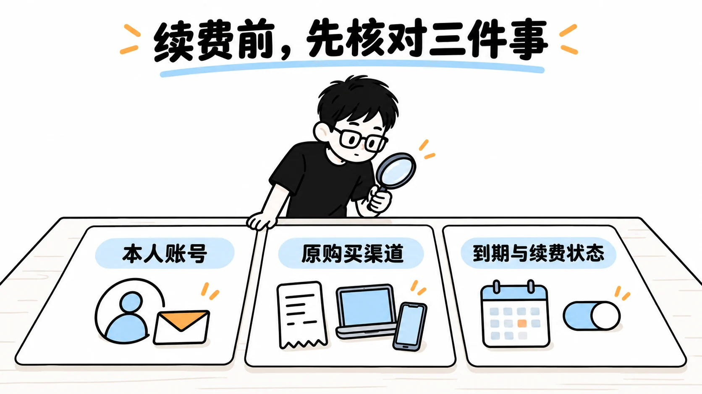

# AI 订阅与账号安全图文指南

由 PayForGPT 与 Nano Banana 内容运营方维护。两站是独立商家，与 OpenAI、Apple、Google 没有隶属关系。本仓库提供可核对来源的教程和购买前检查，文内回链指向我们运营的网站，供进一步查阅。

2026-10-18 新增三篇完整图文稿，每篇两张解释图。配图由生成式工具制作，用于说明概念，不能当作真实支付、账号操作或后台审计的证据。公开规则、商家商品与本人账号状态分别核对；来源复核不等于交易实测。

## 本次图文教程

| 你正在核对的问题 | 完整文章 |
| --- | --- |
| 不用密码却要求 Session JSON，资料代表什么权限？ | [订单材料与账号凭证怎么分](docs/04-account-credentials-and-order-evidence.md) |
| 网页、Apple／Google、商城和 API，谁收款、凭证在哪？ | [付款渠道与账单分流](docs/05-payment-channels-and-billing-records.md) |
| 续费失败是否还可能扣款，新报价能否直接比较？ | [续费前核对账号、原渠道与下一账期](docs/06-renewal-and-price-comparison.md) |

*教学示意：关掉续费、处理旧扣款和建立新订阅分别确认。*

## 其他资料

- [没有海外信用卡时，先核对订阅资格与购买对象](docs/03-plus-without-card.md)：2026-10-18 按公开来源重写，未做真实交易对比。
- [历史 IP 网络自查教程](docs/01-ip-check-tutorial.md)：检测结果只能描述部分网络属性，不能证明服务地区资格或支付一定成功；本次没有重新实测该教程。
- [历史 Codex 购买核对](docs/02-codex-topup-guide.md)：本文不替代当前产品与官方规则，本次没有重新实测该流程。

## 阅读与使用

先核对服务地区、本人账号与实际购买对象，再比较同周期权益、币种税费、资料接收方和售后条件。中国大陆不在本次查阅的 ChatGPT 官方支持地区列表中；商城支持微信或支付宝，不能推导为 OpenAI 网页原生支持或已开放相关地区。参考 [OpenAI 支持地区](https://help.openai.com/en/articles/7947663-chatgpt-supported-countries)。

密码、验证码、Cookie、Session JSON 与 API Key 不作为普通订单备注或聊天核单材料。怀疑泄露时，按各凭证的官方安全与撤销流程分别处理；不要把“不用密码”或“已退款”理解为访问权限已撤销。

站点进一步资料：[PayForGPT 购买与订单帮助](https://payforgpt.com/faq) · [Nano Banana 购买与订单帮助](https://nano-banana.lol/faq)。当前商品、支付与交付条件以各站实际页面为准。
