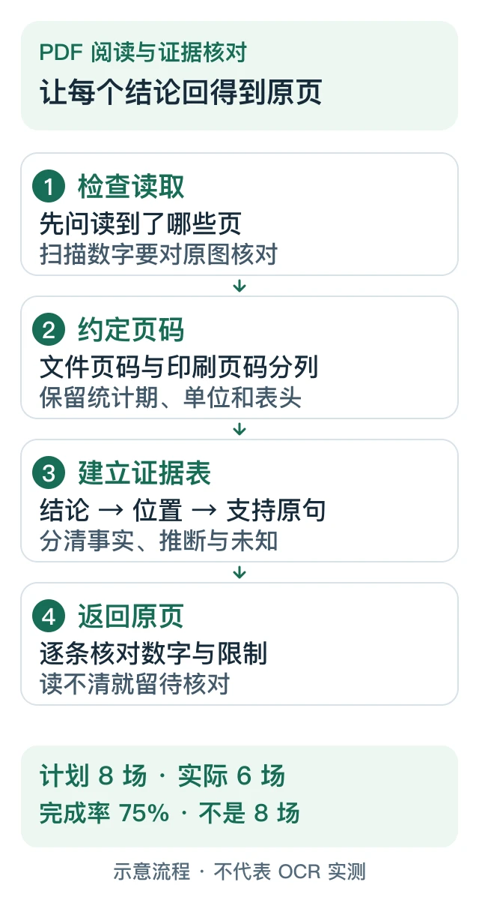

# AI 订阅与工具使用图文指南

由 **PayForGPT 与 Nano Banana 内容运营方**维护的公开教程。两站是独立商家，与 OpenAI、Apple、Google 没有隶属关系；自有站点链接供进一步查阅，不属于独立第三方推荐。这里不接收订单材料、账号凭证或付款。

## 从你要做的事开始

| 现在要解决什么 | 建议阅读顺序 |
| --- | --- |
| 选方案、确认买的是什么 | [平台怎么选](docs/15-provider-selection.md) → [会员、Codex与API账单分流](docs/18-membership-api-wallet.md) → [购买资格](docs/03-plus-without-card.md) |
| 无法绑卡、付款或续费异常 | [国内信用卡条件](docs/11-domestic-card-payment.md) → [绑卡失败分流](docs/12-card-binding-failed.md) → [原续费状态](docs/06-renewal-and-price-comparison.md) |
| 已经付款，想查交付和权益 | [已付仍是Free](docs/14-paid-but-still-free.md) → [工单与客服模板](docs/13-support-ticket-query.md) → [账号材料](docs/04-account-credentials-and-order-evidence.md) |
| 卡密已经收到，想自己激活并核对 | [原订单到套餐周期的五步检查](docs/14-paid-but-still-free.md#card-code-activation-check) |
| iOS提示订阅关联另一个账号 | [原账号与Apple购买核对、完整合成案例](docs/14-paid-but-still-free.md) |
| 找GETGPT官网、核对卡密兑换 | [商家入口与三份记录](docs/19-getgpt-card-code-checklist.md) → [平台比较清单](docs/15-provider-selection.md) |
| 用工具完成具体任务 | [Codex小改动](docs/07-codex-first-task.md) · [PDF证据表](docs/08-pdf-evidence-workflow.md) · [CSV核算](docs/09-spreadsheet-audit-workflow.md) · [PPT大纲](docs/10-presentation-outline-workflow.md) |

*原创解释图，不是产品界面或交易截图；等价步骤见 PDF 教程。*

需要更完整的阅读顺序，查看 [ChatGPT Plus指南阅读地图](docs/17-guide-reading-map.md)；关心账号与权限，查看[免密与不封号承诺核对](docs/16-account-risk-claims.md)。

## 按搜索问题找教程

<!-- BEGIN TOPIC MAP -->
| 主题 | 从搜索问题进入教程 |
| --- | --- |
| 网络排查 | [IP网络信息查询](docs/01-ip-check-tutorial.md) |
| Codex使用 | [Codex怎么购买](docs/02-codex-topup-guide.md) · [Codex第一个任务怎么做](docs/07-codex-first-task.md) |
| 选购与账单 | [没有海外信用卡怎么订阅ChatGPT](docs/03-plus-without-card.md) · [ChatGPT付款渠道怎么区分](docs/05-payment-channels-and-billing-records.md) · [ChatGPT会员和API余额区别](docs/18-membership-api-wallet.md) |
| 账号与材料 | [ChatGPT免密代充要交什么](docs/04-account-credentials-and-order-evidence.md) · [ChatGPT代充安全不封号](docs/16-account-risk-claims.md) |
| 续费与交付 | [ChatGPT续费怎么核对](docs/06-renewal-and-price-comparison.md) · [ChatGPT代充工单查询](docs/13-support-ticket-query.md) · [ChatGPT充值后依然显示Free](docs/14-paid-but-still-free.md) |
| 实用工作流 | [ChatGPT读PDF怎么核对页码](docs/08-pdf-evidence-workflow.md) · [ChatGPT分析CSV怎么核对](docs/09-spreadsheet-audit-workflow.md) · [ChatGPT怎么写PPT大纲](docs/10-presentation-outline-workflow.md) |
| 购买与付款 | [国内信用卡支付ChatGPT](docs/11-domestic-card-payment.md) · [ChatGPT无法绑卡代付](docs/12-card-binding-failed.md) |
| 平台选择 | [ChatGPT充值哪个平台好](docs/15-provider-selection.md) · [GETGPT Pro](docs/19-getgpt-card-code-checklist.md) |
| 教程索引 | [awesome-chatgpt-plus-guide](docs/17-guide-reading-map.md) |
<!-- END TOPIC MAP -->

这张表按任务分组；[关键词与主稿映射](data/keyword-map.json)记录候选主查询、关联问题和对应页面。它是编辑规划，不是搜索量或已排名词库。相同主意图集中到一篇，关联问题放进分支、FAQ与相关教程。

## 最近复核的教程

<!-- BEGIN LATEST -->
| 复核日期 | 教程 |
| --- | --- |
| 2026-10-25 | [ChatGPT会员、API余额和用量点数：购买前找对账单](docs/18-membership-api-wallet.md) |
| 2026-10-25 | [ChatGPT已付款仍显示Free：分开核对付款、交付与权益](docs/14-paid-but-still-free.md) |
| 2026-10-21 | [Codex 购买前先核对：登录方式、当前可用功能与实际用量](docs/02-codex-topup-guide.md) |
| 2026-10-19 | [GETGPT Pro 购买前核对：官网、卡密兑换与原账号结果](docs/19-getgpt-card-code-checklist.md) |
| 2026-10-19 | [awesome ChatGPT Plus guide阅读地图：从问题找到来源和下一步](docs/17-guide-reading-map.md) |
| 2026-10-19 | [ChatGPT代充安全不封号可信吗：先检查账号权限和承诺边界](docs/16-account-risk-claims.md) |
| 2026-10-19 | [ChatGPT充值哪个平台好：按交付类型、条件和售后比较](docs/15-provider-selection.md) |
| 2026-10-19 | [ChatGPT代充工单查询：按原订单整理证据和回复](docs/13-support-ticket-query.md) |
| 2026-10-19 | [ChatGPT无法绑卡怎么办：从失败位置判断下一步](docs/12-card-binding-failed.md) |
| 2026-10-19 | [国内信用卡支付ChatGPT：地区、发卡行与付款渠道怎么核对](docs/11-domestic-card-payment.md) |
<!-- END LATEST -->

复核日是编辑读取来源与修订的日期，不代表所有产品或交易已实测。CSV、页码练习和小任务均为合成示例，文内分别说明验算与未验证部分。

## 价格观察与比较条件

[查看8个公开来源的观察表](data/prices/latest.md)。记录请求结果、来源、时间和能识别的商品信息；抓不到或条件不清保留未知。币种、周期、税费、交付类型和资格不同的商品不直接比较，不宣称全网最低。

实体 SIM 与开票条件需具体商品或客服确认，不默认竞品没有，不将实体卡写成防封保证。商业 invoice、国内税务发票及报销要求分别确认，工具不生成或认证发票。

## 完整目录与稳定归档

<!-- BEGIN ARCHIVE -->
- [IP 网络信息怎么读：地区、ASN 与第三方标签分别核对](docs/01-ip-check-tutorial.md) · [稳定归档](articles/ip-network-information.md)
- [Codex 购买前先核对：登录方式、当前可用功能与实际用量](docs/02-codex-topup-guide.md) · [稳定归档](articles/codex-access-and-usage.md)
- [没有海外信用卡时，先核对订阅资格与购买对象](docs/03-plus-without-card.md) · [稳定归档](articles/subscription-eligibility.md)
- [免密代充要交什么？先把订单材料和账号钥匙分开](docs/04-account-credentials-and-order-evidence.md) · [稳定归档](articles/account-credentials-and-order-evidence.md)
- [ChatGPT 付款方式怎么核对：先认清买的是什么、谁在收款](docs/05-payment-channels-and-billing-records.md) · [稳定归档](articles/payment-channels-and-billing-records.md)
- [ChatGPT 续费前的三次核对：账号、原渠道、下一账期](docs/06-renewal-and-price-comparison.md) · [稳定归档](articles/renewal-and-price-comparison.md)
- [Codex 第一个小任务：修复一个边界值，并留下可审查的证据](docs/07-codex-first-task.md) · [稳定归档](articles/codex-first-task.md)
- [用 ChatGPT 读 PDF：做一张能回到原页核对的证据表](docs/08-pdf-evidence-workflow.md) · [稳定归档](articles/pdf-evidence-workflow.md)
- [用 ChatGPT 核对 CSV：先定口径，再查重复、缺失与合计](docs/09-spreadsheet-audit-workflow.md) · [稳定归档](articles/spreadsheet-audit-workflow.md)
- [用 ChatGPT 写 PPT 大纲：先核对结论，再安排每一页](docs/10-presentation-outline-workflow.md) · [稳定归档](articles/presentation-outline-workflow.md)
- [国内信用卡支付ChatGPT：地区、发卡行与付款渠道怎么核对](docs/11-domestic-card-payment.md) · [稳定归档](articles/domestic-card-payment.md)
- [ChatGPT无法绑卡怎么办：从失败位置判断下一步](docs/12-card-binding-failed.md) · [稳定归档](articles/card-binding-failed.md)
- [ChatGPT代充工单查询：按原订单整理证据和回复](docs/13-support-ticket-query.md) · [稳定归档](articles/support-ticket-query.md)
- [ChatGPT已付款仍显示Free：分开核对付款、交付与权益](docs/14-paid-but-still-free.md) · [稳定归档](articles/paid-but-still-free.md)
- [ChatGPT充值哪个平台好：按交付类型、条件和售后比较](docs/15-provider-selection.md) · [稳定归档](articles/provider-selection.md)
- [ChatGPT代充安全不封号可信吗：先检查账号权限和承诺边界](docs/16-account-risk-claims.md) · [稳定归档](articles/account-risk-claims.md)
- [awesome ChatGPT Plus guide阅读地图：从问题找到来源和下一步](docs/17-guide-reading-map.md) · [稳定归档](articles/guide-reading-map.md)
- [ChatGPT会员、API余额和用量点数：购买前找对账单](docs/18-membership-api-wallet.md) · [稳定归档](articles/membership-api-wallet.md)
- [GETGPT Pro 购买前核对：官网、卡密兑换与原账号结果](docs/19-getgpt-card-code-checklist.md) · [稳定归档](articles/getgpt-card-code-checklist.md)
<!-- END ARCHIVE -->

每篇主稿只有一个稳定归档，副本不另算新文章。网络排查见 [IP、ASN与标签](docs/01-ip-check-tutorial.md)，网络属性不能证明账号或付款资格。

## 来源、安全与更正

密码、验证码、Cookie、Session JSON、API key 和查单密码不作为公开教程或普通核单材料。内容错误请提供脱敏段落与来源，见 [安全说明](SECURITY.md)、[贡献流程](CONTRIBUTING.md)及[更新记录](CHANGELOG.md)。

2026-10-19 已修正旧01/02的网络安全与Codex计费过度断言；Git历史保留用于追溯。规则仍需结合官方最新说明和本人账号核对。

进一步资料：[PayForGPT购买与订单帮助](https://payforgpt.com/faq?utm_source=github&utm_medium=referral&utm_campaign=ai_subscription_guide_readme_payforgpt) · [Nano Banana购买与订单帮助](https://nano-banana.lol/faq?utm_source=github&utm_medium=referral&utm_campaign=ai_subscription_guide_readme_nano)。实际商品、价格、支付和交付条件以各站页面为准。

## 自动维护与复用

每日UTC02:00（北京时间10:00）的 [Actions](https://github.com/hyai-dev/ai-subscription-guide/actions/workflows/daily-sync.yml)计划检查已审阅稿件、观察价格、同步稳定归档与导航；调度可能延迟，以每次运行记录为准。没有内容变化不伪造复核日；脚本不自动创作、代充或修改飞书。

先运行 `npm run sync:preview` 本地预览。流程见[维护手册](ops/maintenance.md)。 最新[公开竞品证据复核](ops/competitor-public-evidence-20261020/README.md)区分真实外链、当前正文、流量估算与待实施建议。主题与站点链接已加来源标记，付款/交付归因仍需验收，见[归因范围](ops/measurement.md)。

原创代码：[MIT](LICENSE)；文字和图示：[内容许可与第三方边界](CONTENT-LICENSE.md)。欢迎有来源的更正和实际使用反馈。
