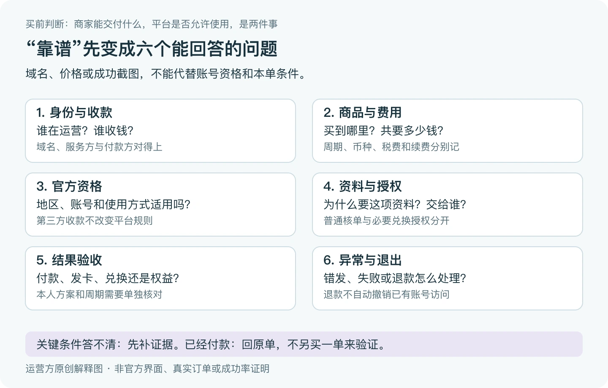

> 本文是[主稿](https://github.com/hyai-dev/ai-subscription-guide/blob/main/docs/16-account-risk-claims.md)的稳定归档，由 PayForGPT 与 Nano Banana 内容运营方维护。原稿发表：2026-10-19；复核：2026-10-25。修订原稿后同步本文件，不按日期重复增加文章数。

# ChatGPT代充安全不封号可信吗：先检查账号权限和承诺边界

首次发布：2026-10-19；最近复核：2026-10-25。由 PayForGPT 与 Nano Banana 内容运营方整理。两站由同一运营方维护，均为独立第三方服务；本文不是独立第三方推荐，也没有在不同商家下单比较、统计封号率或验证任何商家的“零风险”承诺。

<a id="recharge-risk-evidence"></a>

## ChatGPT代充靠谱吗？先把这六件事问清

如果你还没购买，先留下**谁收款、买什么、本人是否符合官方条件、要交什么资料、在哪里验收、异常找谁处理**这六项记录。少一项，就先补这一项；不用先找一张“成功截图”说服自己付款。



运营方原创解释图，不是官方界面、真实订单或成功率证据。[可缩放SVG](../assets/final-plan-20261025/purchase-risk-six-checks.svg)。

| 需要回答的问题 | 找哪一份记录 | 没有答案时怎样处理 |
| --- | --- | --- |
| 实际由谁提供服务和收款？ | 当前域名、经营说明、付款页与公开联系方式 | 先核对不一致之处，不直接向陌生私聊收款码付款 |
| 买的是会员、卡密、账号访问还是API用量？ | 本单商品、周期、币种、税费和续费规则 | 请卖方写明交付对象，不能用相同名称横比价格 |
| 本人是否符合平台规则？ | 官方支持地区、账号与使用条款 | 商家能收款也不能替平台确认使用资格 |
| 额外资料为什么需要、由谁接收？ | 对应兑换步骤的用途、接收方和权限说明 | 普通核单不交账号钥匙；必要兑换授权另行判断 |
| 怎样知道结果符合约定？ | 原订单、交付/兑换记录、本人账号的方案与周期 | 把未发货、待激活、处理中和已核对分开，不重复买一单测试 |
| 失败或退出怎样处理？ | 当单适用的补发、退款、争议和账号访问处理说明 | 先确认具体条件，不把口头“全包”当作结果 |

**商家收款和官方资格是两件事。**OpenAI当前[支持地区页面](https://help.openai.com/en/articles/7947663-chatgpt-supported-countries)没有列出中国大陆，并说明在支持范围外访问或提供访问可能导致账号受限。[使用条款](https://openai.com/policies/row-terms-of-use/)也对共享凭证、出售或出租服务、绕过限制设有约束。因此，“用本人账号”“没交密码”“支持本地支付”都不能单独证明某次交易符合官方规则。这里不提供改区或绕过限制的方法，也不替任何商家作合规认证。

## 官方订阅、卡密服务和共享账号有什么区别？

| 看到的购买路径 | 最容易混淆的地方 | 应核对什么 |
| --- | --- | --- |
| 在官方支持的渠道订阅本人账号 | 付了款却登录了另一账号，或把App商店和网页账单混在一起 | 原渠道、本人账号和订阅周期；有异常回原渠道 |
| 向独立商家购买卡密或订阅协助 | 卡密已收到，被误当作会员已生效 | 商家原订单、实际兑换步骤、必要授权、本人账号结果和适用条款 |
| 购买多人共用的登录凭证 | 把“车位”“独享名额”当作个人账号归属 | 谁创建、恢复和控制账号；不以共享登录替代本人订阅 |
| API项目或第三方网关用量 | 有余额，被误当作ChatGPT会员或Codex套餐 | 具体服务商、组织/项目、授权与独立账单 |

这张表区分购买对象，不是风险高低排名。第三方服务的支付、账号权限、平台条款和实际履约需要分别判断；钱退回来，也不自动意味着已有会话或Key访问已经撤销。订阅与API的账本区别见[购买前找对账单](../docs/18-membership-api-wallet.md)。

## “永久会员”“年卡很便宜”，怎样核对？

先让卖方写出准确产品与周期。OpenAI的[Plus说明](https://help.openai.com/en/articles/6950777-what-is-chatgpt-plus)当前列为按月订阅，并明确Plus暂不支持年付或多月预付。商家自己打包的长期服务不因此变成官方Plus年付计划；Business等其他产品也不能拿来证明个人Plus的年卡规则。

看到“永久”时，要求解释具体交付、服务期限、到期处理和责任方；当前官方方案页没有对应承诺，就不能按“官方永久会员”理解。低价本身不足以证明诈骗，高价也不证明安全。关键是条件是否真实、可核对，并符合本人资格；解释不清就不要先付钱赌结果。

```text
我准备买的准确商品、周期和交付对象：
官方资格与规则来源、查看日期：
实际服务方、收款方与完整费用：
本单要求的资料、接收方、用途和权限：
在哪里核对账号方案与周期：
异常适用条件、原单查询和处理方：
还没回答清楚的一项：
```

只把这张空表用于自己的笔记；不用将真实订单、凭证或账号资料提交到公开仓库。若你已付款，先记录原单与实际状态，再沿原商家处理。

## “不封号”不能替代哪几项检查？

上面的六项用于买前记录；下面补充账号归属、授权与已交资料的处理细节。本教程没有证据把任一商家、外卡、IP标签或实体SIM判定为零封号风险；不能把营销承诺当作平台账号政策。


等价步骤：账号归属 → 资料权限 → 交付验收 → 售后边界。[SVG源](../assets/keyword-tasks-20261019/account-risk-check.svg)

## 第一项：独享账号和共享账号怎么分？

问清楚谁创建、谁控制、谁能恢复账号，以及是否多人使用同一登录凭证。OpenAI账号面向创建者本人；同一人使用多台设备与多人共用账号不是一回事。[官方账号使用政策](https://help.openai.com/en/articles/10471989-openai-account-sharing-policy)

“独享”“原号”“专属车位”只是商品描述，不能单凭词语推导官方授权或零风险。购买后仍需核对真实交付对象。

## 第二项：免密代充安全吗？

不要求密码，仍可能要求其他有访问能力的资料。Cookie、Session JSON、访问令牌与API key不是普通订单材料；各自的权限、有效期和撤销方式也不能混为一谈。OWASP说明有效会话标识可能临时承载认证能力。[会话管理说明](https://cheatsheetseries.owasp.org/cheatsheets/Session_Management_Cheat_Sheet.html)

```text
付款或核单需要的材料：订单号、必要的脱敏交易信息
我被要求提交的额外资料：
接收方、用途、访问权限、保存及撤销说明：
哪些说明尚未确认：
```

不要在公开工单、聊天记录或源码中提交密码、验证码、完整Cookie/Session或API key。具体材料分级看[订单证据与账号钥匙](../docs/04-account-credentials-and-order-evidence.md)。

## 第三项：把保证写成可核对的条款

| 商家说法 | 应进一步确认 |
| --- | --- |
| 免密 | 实际还要什么资料，权限与处理方式是什么？ |
| 已到账 | 哪个账号、什么套餐、什么周期，怎样验收？ |
| 售后保障 | 适用问题、材料、期限与处理方分别是什么？ |
| 退款 | 是否有明确资格与流程，如何处理已有访问权限？ |
| 不封号 | 依据是什么，哪些结果不受商家控制？ |

退款、订单关闭和账号访问撤销分别确认。某项售后承诺即使存在，也不能替代平台规则或保证实际履行。

## 第四项：怀疑资料泄露怎么办？

先停止在原聊天或公开页面继续发送资料，按凭证所属平台的官方流程处理账号会话、密码或具体key，再记录事件与联系渠道。不同凭证采取不同措施；不要把删除消息、退出某一设备或收到退款当作所有访问已撤销。[OpenAI账号安全](https://help.openai.com/en/articles/8304786-keeping-your-openai-account-secure)、[API key安全](https://help.openai.com/en/articles/5112595-best-practices-for-api-key-safety)

## 常见问题

**ChatGPT代充一定会封号吗？** 本文没有对某商家或交易建立这样的概率结论，也没有零风险结论。按账号政策与具体证据判断。

**Session JSON一定能完全接管账号吗？** 不能把所有凭证的权限说成相同；但有效会话资料需要按敏感访问材料对待。

**有实体卡或住宅IP就安全了吗？** 这些不能单独证明平台资格、账号控制或付款结果，见[网络标签解释](../docs/01-ip-check-tutorial.md)。

选择商品时，可用[六项平台核对表](../docs/15-provider-selection.md)。本文未执行账号授权、泄露实验或封号率测试。


进一步说明：[PayForGPT当前订单与售后边界](https://payforgpt.com/trust?utm_source=github&utm_medium=referral&utm_campaign=risk_check_payforgpt)、[Nano Banana个人与工作区购买方式比较](https://nano-banana.lol/blog/is-chatgpt-plus-recharge-safe?utm_source=github&utm_medium=referral&utm_campaign=risk_check_nano#section-1-1n19wf7)。这两个站点由同一运营方经营，链接按交易核验与选购比较分工，不构成独立背书；已经付款仍沿原站点的订单与售后规则处理。

---

相关资料：[PayForGPT当前订单与售后边界](https://payforgpt.com/trust?utm_source=github&utm_medium=referral&utm_campaign=risk_check_payforgpt) · [Nano Banana个人与工作区购买方式比较](https://nano-banana.lol/blog/is-chatgpt-plus-recharge-safe?utm_source=github&utm_medium=referral&utm_campaign=risk_check_nano#section-1-1n19wf7)。链接指向我们运营的网站；商品、支付和交付条件以实际页面为准。
