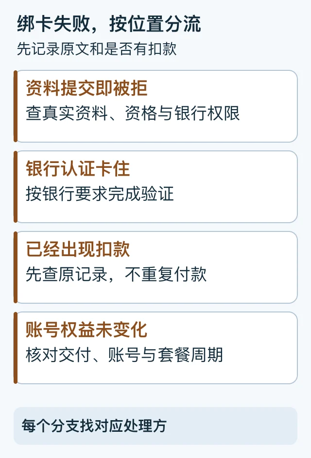

> 本文是[主稿](https://github.com/hyai-dev/ai-subscription-guide/blob/main/docs/12-card-binding-failed.md)的稳定归档，由 PayForGPT 与 Nano Banana 内容运营方维护。原稿发表：2026-10-19；复核：2026-10-19。修订原稿后同步本文件，不按日期重复增加文章数。

# ChatGPT无法绑卡怎么办：从失败位置判断下一步

首次发布与复核：2026-10-19。由 PayForGPT 与 Nano Banana 内容运营方整理。

## 先确定卡在什么地方

“无法绑卡”“3DS失败”“付款一直转圈”和“已扣款没升级”需要不同处理。先记录**页面所属渠道、错误原文、发生时间、有无扣款**，再走对应分支，不连续新建订单。



等价步骤：确定失败位置 → 找对应处理方 → 回看原付款 → 核对账号结果。[SVG源](../assets/keyword-tasks-20261019/card-failure-branches.svg)

## 第一步：保留四项信息

```text
在哪里付款：官方网页 / 应用商店 / 商家原订单
实际错误文字：
发生时间与当前状态：
银行或原渠道是否有记录：无 / 待处理 / 已确认 / 需核对
```

截图应遮住完整卡号、验证码、Cookie、会话和查单密码。不要向公开论坛贴完整账单。

## 第二步：用失败位置选动作

| 看到的情况 | 先检查什么 | 谁能协助 |
| --- | --- | --- |
| 添加资料或提交时即被拒绝 | 支持地区、真实账单、余额和银行权限 | 原平台、发卡行 |
| 银行认证没有完成 | 是否被拦弹窗、重定向或银行App确认要求 | 原平台、发卡行 |
| 一直转圈、返回页没有明确结果 | 原渠道是否已有付款，页面是否仍在处理 | 原渠道支持 |
| 银行有扣款、商家还在核对 | 交易记录与对应原订单 | 原商家，不重付 |
| 显示已发货，但账号仍是Free | 交付材料、兑换结果、账号及工作区 | 按[权益验收](../docs/14-paid-but-still-free.md)核对 |

OpenAI 拒付帮助建议核对真实资料、余额与地区，必要时联系银行。遇到银行验证页面被拦，可按官方指引检查浏览器拦截与重定向；验证码只在核实后的银行或官方流程中输入。[官方拒付排查](https://help.openai.com/en/articles/7232916-why-was-my-credit-card-declined)

## 第三步：分清认证、设置支付方式和收费

完成银行认证不单独证明已经收费；设置支付方式成功也不代表这次付款成功。Stripe 文档区分 SetupIntent 和实际处理支付的 PaymentIntent；这些是通用机制说明，不能凭教程替读者猜测私有后台状态。[付款状态生命周期](https://docs.stripe.com/payments/paymentintents/lifecycle)、[3DS认证流程](https://docs.stripe.com/payments/3d-secure/authentication-flow)

如果界面没有提供状态代码，就记录界面实际文字，不自行补写 `succeeded`。需要的是原渠道明确的结果，以及目标账号的权益验收。

## 第四步：考虑代付前，先结束原问题

对“ChatGPT无法绑卡代付”这一需求，建议先回答：原单是否仍可能扣款？另一方案交付到哪个账号？是否需要提交敏感资料？售后由谁负责？按[平台选择核对表](../docs/15-provider-selection.md)记录，不能因为另一家能收人民币，就认定账号资格、旧账单和凭证风险已解决。

## 常见问题

**换浏览器一定能成功吗？** 不能保证；它只可能排除部分浏览器问题。

**出现 generic_decline 就是永久封卡吗？** 不是这个代码本身的含义。原因可能未知或涉及风险规则，应按原平台与银行的信息判断。[拒付代码说明](https://docs.stripe.com/declines/codes)

**已经扣款，可以再付一次试试吗？** 先查询原记录，避免把重复付款当成权益同步方法。

下一步：[国内信用卡资格核对](../docs/11-domestic-card-payment.md) · [工单与客服材料](../docs/13-support-ticket-query.md)。本文未进行实际绑卡或支付测试。

---

相关资料：[PayForGPT对应任务帮助](https://payforgpt.com/ai-subscriptions/chatgpt-payment-channels-guide?utm_source=github&utm_medium=referral&utm_campaign=ai_subscription_guide_card_binding_failed_payforgpt#bank-card-payment) · [Nano Banana对应任务帮助](https://nano-banana.lol/ai-subscriptions/alipay-wechat-pay?utm_source=github&utm_medium=referral&utm_campaign=ai_subscription_guide_card_binding_failed_nano#card-binding-help)。链接指向我们运营的网站；商品、支付和交付条件以实际页面为准。
