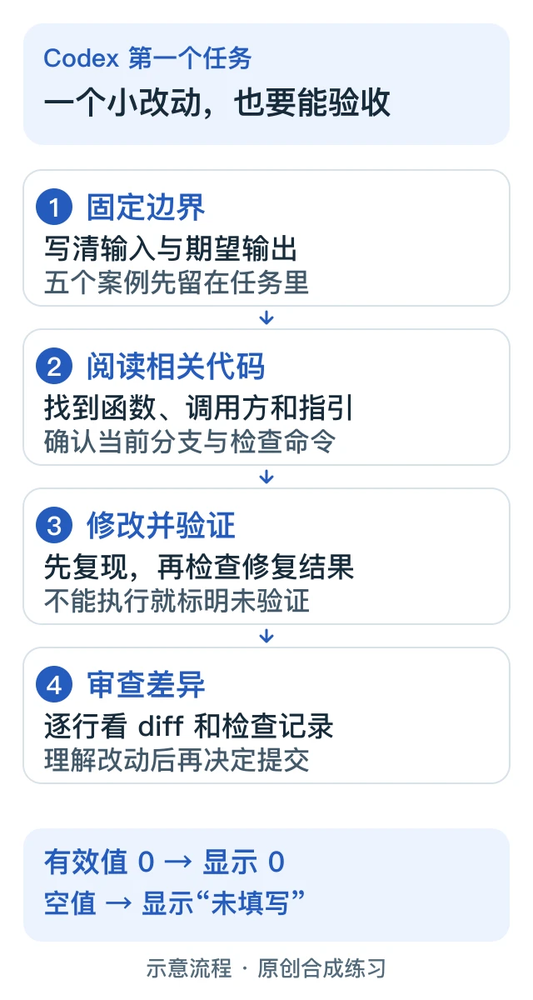

> 本文是[主稿](https://github.com/hyai-dev/ai-subscription-guide/blob/main/docs/07-codex-first-task.md)的稳定归档，由 PayForGPT 与 Nano Banana 内容运营方维护。原稿发表：2026-10-19；复核：2026-10-19。修订原稿后同步本文件，不按日期重复增加文章数。

# Codex 第一个小任务：修复一个边界值，并留下可审查的证据

复核日期：2026-10-19。本文是原创练习流程；示例代码和预期结果均为合成材料，没有宣称经过某个模型或真实生产项目实测。

## 30 秒先看结果

第一次用 Codex，可以从一个函数的小问题开始：**订单参考号为数字 `0` 时，应该显示 `0`，而不是“未填写”。**交付物包括一份小范围 diff、边界值检查结果和未完成项。完成后再决定是否提交或发布。

不必先购买新套餐。先确认你现有账号、工作区和客户端能否使用所需功能。官方区分 ChatGPT 登录与 API key 登录，两者的用量和计费路径不同；本文采用已有可用访问，不创建 API 调用。[官方登录说明](https://learn.chatgpt.com/docs/auth)

## 准备条件

- 一个你有权修改、已备份或已有 Git 检查点的项目；优先选不涉及付款、登录或真实客户数据的练习副本。
- 已能使用 Codex 的客户端。CLI 用户可从[官方 CLI 指南](https://learn.chatgpt.com/docs/codex/cli)完成安装和登录；界面名称变化时以当前官方页面为准。
- 项目自己的运行与检查命令。不要直接把教程里的 Node.js 命令套到 Python、Java 或其他工程。



图解：先写验收条件，再让 Codex 修改。等价文字顺序为“固定边界 → 阅读相关代码 → 修改并验证 → 人工审查”。[可编辑 SVG](../assets/practical-20261019/codex-small-change.svg)

## 步骤 1：把任务缩小到一个能判定对错的行为

下面是故意带有问题的合成示例，文件名可假设为 `order-reference.mjs`：

```js
export function formatOrderReference(reference) {
  return reference ? String(reference) : '未填写';
}
```

为这个练习明确输入范围：字符串、数字、`null`、`undefined`。不增加自动去空格、编号校验或对象序列化等额外规则。

| 输入 | 期望文本 | 验收原因 |
|---|---|---|
| `0` | `0` | 数字零是有效值 |
| `'A-07'` | `A-07` | 普通编号保持原样 |
| `''` | `未填写` | 空字符串缺失 |
| `null` | `未填写` | 明确无值 |
| `undefined` | `未填写` | 未传值 |

这是练习要求，不代表所有业务都应采用这套规则。真实项目要先检查调用方是否允许 `0`。

## 步骤 2：先让 Codex 阅读上下文

打开正确的项目目录，说明目标和范围。让 Codex 读取仓库指引、定位函数与调用方，报告当前 Git 状态和相关检查命令，再按下方模板执行。已有未提交修改时，先辨认归属，不能覆盖别人的工作。

可复制提示词：

```text
在当前项目修复一个小问题：formatOrderReference(0) 应返回字符串“0”。
先读取适用的仓库指引，定位函数、调用方和现有测试，报告基线状态。
只处理字符串、数字、null、undefined；空字符串、null、undefined 返回“未填写”。
保留“A-07”等非空输入，不新增自动去空格或编号格式规则。
复用现有测试框架，覆盖上表五个输入；检查确实能暴露原问题。
不要顺带重构、更新依赖、改认证/付款流程、提交、推送或部署。
完成后给出修改文件、diff 摘要、实际运行的命令、退出状态和未验证部分。
测试跑不了就说明缺什么，不要声称通过，也不要删断言来消除失败。
```

官方的测试型任务指南也强调先建立基线，再保留实现与验收证据。[从问题到可测试改动](https://learn.chatgpt.com/use-cases/issue-to-tested-pr)

## 步骤 3：用固定案例检查结果

如果你按示例建立了 Node.js 练习文件，可在同目录建立 `order-reference.test.mjs`：

```js
import assert from 'node:assert/strict';
import { formatOrderReference } from './order-reference.mjs';

const cases = [
  [0, '0'], ['A-07', 'A-07'], ['', '未填写'],
  [null, '未填写'], [undefined, '未填写'],
];
for (const [input, expected] of cases) {
  assert.equal(formatOrderReference(input), expected);
}
console.log('5 个边界案例通过');
```

运行 `node order-reference.test.mjs`。原示例在 `0` 上应失败；修复后五个案例应通过。真实项目还应运行受影响的现有检查。**本文提供的是预期验收标准；你自己的运行记录才是该次修改的证据。**

## 步骤 4：审查 diff，再决定下一步

逐行看 diff：是否只改了缺失值判断？是否动了其他调用方、配置、依赖或凭证？检查输出是否对应当前这份代码，不能拿修改前或另一个分支的绿色结果代替。需要时再让 Codex 做一次针对未提交修改的审查；审查建议仍需结合代码和检查结果判断。[官方 CLI 的审查入口](https://learn.chatgpt.com/docs/codex/cli)

通过标准是：五个边界符合约定、相关现有检查完成、差异范围合理、限制明确。对自己不理解的 diff，先要求解释到具体输入和输出，再提交。

## 卡住时怎么处理

| 情况 | 下一步 |
|---|---|
| 项目基线已经失败 | 记录原有失败，先定位环境或既有问题，避免把它算成这次修复效果 |
| 找不到函数或调用方不允许 `0` | 明确实际行为与业务规则，重新缩小问题，不照抄示例 |
| 没有工具权限或 Node.js | 先完成代码阅读与预期表；把执行检查标记为未完成 |
| 额度或功能不可用 | 先核对当前账号的用量、权限与登录方式，不反复重试或自动换购套餐 |
| 改动突然涉及迁移、依赖或认证 | 拆分新任务，保留当前 diff 和未决问题 |

继续练习：[用表格样例核对计算](../docs/09-spreadsheet-audit-workflow.md)。涉及账号材料时，先看[凭证与订单证据说明](../docs/04-account-credentials-and-order-evidence.md)。

## 官方来源与适用范围

- [Codex CLI](https://learn.chatgpt.com/docs/codex/cli)：本地代码阅读、修改、命令与审查流程。
- [Authentication](https://learn.chatgpt.com/docs/auth)：ChatGPT 与 API key 登录方式不同。
- [Pricing](https://learn.chatgpt.com/docs/pricing)：访问、用量和功能受套餐、工作区及开放范围影响；本文不固化价格或额度。
- [Turn an issue into a tested pull request](https://learn.chatgpt.com/use-cases/issue-to-tested-pr)：基线、验收与失败记录的原则。

以上官方正文已于 2026-10-19 读取。原创函数、提示词和验收表属于本教程设计，不是官方案例或性能评测。
