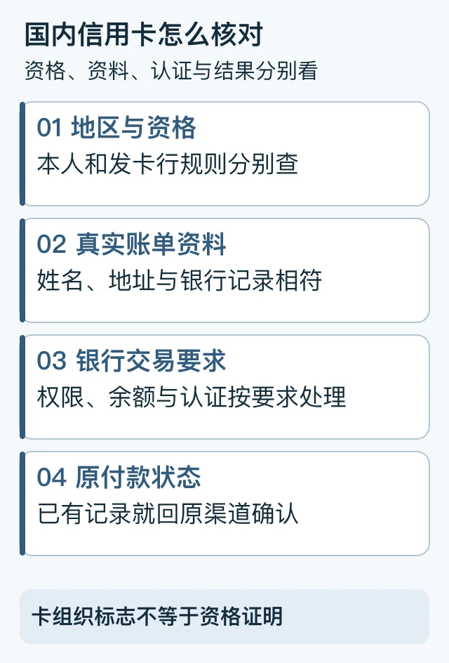

> 本文是[主稿](https://github.com/hyai-dev/ai-subscription-guide/blob/main/docs/11-domestic-card-payment.md)的稳定归档，由 PayForGPT 与 Nano Banana 内容运营方维护。原稿发表：2026-10-19；复核：2026-10-19。修订原稿后同步本文件，不按日期重复增加文章数。

# 国内信用卡支付ChatGPT：地区、发卡行与付款渠道怎么核对

首次发布与复核：2026-10-19。由 PayForGPT 与 Nano Banana 内容运营方整理。

## 先回答：国内银行卡为什么付不了 ChatGPT？

不能只看卡面上的 Visa、Mastercard 或“双币”字样。官方拒付帮助要求同时核对**本人所在地、发卡银行所在地、真实账单资料和银行交易权限**。中国大陆不在本次读取的 ChatGPT 官方支持地区列表中；购买外卡、海外手机号或商家服务不会自动改变资格。[官方拒付帮助](https://help.openai.com/en/articles/7232916-why-was-my-credit-card-declined)、[支持地区](https://help.openai.com/en/articles/7947663-chatgpt-supported-countries)

先完成下面三项，再判断是资格、资料还是付款状态问题。



图解顺序：查资格 → 查资料 → 查银行要求 → 查实际状态。[SVG源](../assets/keyword-tasks-20261019/domestic-card-check.svg)

## 第一步：确定你在哪个渠道付款

| 当前页面 | 谁负责该笔付款 | 去哪里核对 |
| --- | --- | --- |
| ChatGPT 网页结账 | 官方网页订阅渠道 | 当前账号、账单与官方帮助 |
| Apple / Google 商店 | 对应应用商店 | 商店订阅、收据与付款方式 |
| 第三方商家商城 | 该商家 | 原订单、具体交付条件和商家客服 |

商家支持支付宝，只说明商家订单的收款方式；不能把它当成 OpenAI 网页原生支持。完整渠道关系见[付款渠道与账单](../docs/05-payment-channels-and-billing-records.md)。

## 第二步：把资格和资料分别确认

1. 对照官方当前支持地区，核对本人所在地区与发卡行地区；不能靠 IP 数据库标签替代。
2. 账单姓名、地址、邮编、有效期等应与真实资料一致。不要照搬他人的“免税州地址”。
3. 确认余额、线上或境外支付权限，以及银行是否需要 App 或其他认证。
4. 有具体拒付时记录原文、时间和渠道。OpenAI 通常拿不到银行详细拒付原因，需要时联系发卡行。

检查表可以这样填，不写卡号、验证码或安全码：

```text
付款渠道：网页 / Apple / Google / 商家
本人地区是否符合当前规则：符合 / 不符合 / 未确认
发卡行地区是否符合规则：符合 / 不符合 / 未确认
真实账单资料与银行权限：已核对 / 需处理
报错原文、时间、是否出现实际扣款：
下一步由谁处理：发卡行 / 原平台 / 原商家
```

## 第三步：按结果分流

| 结果 | 下一步 |
| --- | --- |
| 资格未确认 | 停在资格核对，不把更换支付工具当作解决办法 |
| 资料或银行权限有误 | 按真实信息修正，必要时联系银行 |
| 认证页打不开或一直转圈 | 进入[绑卡与认证失败排查](../docs/12-card-binding-failed.md) |
| 已扣款但权益没变化 | 先查原记录，再看[付款后仍是Free](../docs/14-paid-but-still-free.md) |

## 常见问题

**有外币卡就能支付吗？** 不能保证。卡组织、币种和地区资格不是同一个条件。

**账单地址怎么填？** 填与你的真实付款资料相符的信息；不使用教程中的虚构地址。

**绑卡失败要马上找代付吗？** 先确认原因和原支付状态，再核对第三方商品与资料要求。另一种收款方式并不证明原问题已解决。

本文是有来源的核对流程，未执行真实刷卡或测试通过率。网络字段含义可查[IP信息教程](../docs/01-ip-check-tutorial.md)。

---

相关资料：[PayForGPT对应任务帮助](https://payforgpt.com/ai-subscriptions/chatgpt-payment-channels-guide?utm_source=github&utm_medium=referral&utm_campaign=ai_subscription_guide_domestic_card_payment_payforgpt#bank-card-payment) · [Nano Banana对应任务帮助](https://nano-banana.lol/ai-subscriptions/alipay-wechat-pay?utm_source=github&utm_medium=referral&utm_campaign=ai_subscription_guide_domestic_card_payment_nano#domestic-card-eligibility)。链接指向我们运营的网站；商品、支付和交付条件以实际页面为准。
