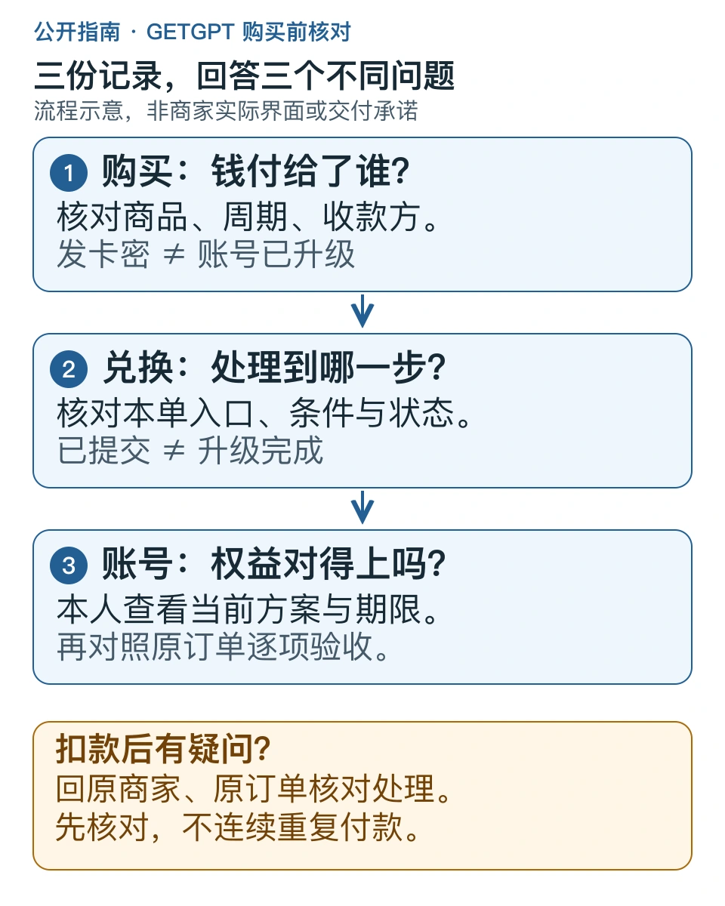

> 本文是[主稿](https://github.com/hyai-dev/ai-subscription-guide/blob/main/docs/19-getgpt-card-code-checklist.md)的稳定归档，由 PayForGPT 与 Nano Banana 内容运营方维护。原稿发表：2026-10-19；复核：2026-10-19。修订原稿后同步本文件，不按日期重复增加文章数。

# GETGPT Pro 购买前核对：官网、卡密兑换与原账号结果

首次发布与复核：2026-10-19。由 PayForGPT 与 Nano Banana 内容运营方维护，与下文商家没有隶属关系。本文依据公开页面整理核对方法，没有在 GETGPT 下单或完成充值实测。

## 搜到 GETGPT，先明确要办哪件事

如果你正在找“GETGPT Pro”“GETGPT”或“getgpt.pro官网”，先区分商家入口与 ChatGPT 官方服务。本文核对的商家站点是 [getgpt.pro](https://getgpt.pro/)；其[服务条款](https://getgpt.pro/terms)明确声明它是独立第三方服务。名字中有 GPT 或 Pro，不表示 OpenAI 官方授权。

还没购买，先看商品、账号条件和条款；已经付款，优先回原订单核对状态。下面的流程不要求你重新购买，也不要求把任何卡密或登录凭证发到 GitHub。

文字版：购买订单证明这笔交易的商品与付款情况；兑换记录说明处理到了哪一步；本人账号的方案与期限才是权益验收的一部分。三者需要对照，不能相互代替。[可编辑SVG](../assets/getgpt-check-20261019/three-records.svg)

## 购买前，用一张表留下可核对的信息

| 要核对的事 | 应在哪里找 | 留下什么记录 |
| --- | --- | --- |
| 买到什么 | 对应商品和订单说明 | 套餐名称、交付对象、周期与完整费用 |
| 账号能否使用 | 当前商品条件及核验提示 | 当前订阅、登录方式及不适用条件 |
| 下一步做什么 | 订单页和对应教程 | 是继续兑换卡密，还是等待系统处理 |
| 异常如何处理 | 商品说明、FAQ和服务条款 | 原单入口、材料要求与售后适用条件 |

GETGPT 的[公开FAQ](https://getgpt.pro/faq)说明，不同套餐和充值通道的要求可能不同；[Pro商品页](https://getgpt.pro/gptpro)也不能替代具体订单条件。不要从另一家商店的教程推定本单适用，也不要只保存优惠宣传而不保存最终商品说明。

## GETGPT卡密兑换：把三个状态分开记录

其[图文教程](https://getgpt.pro/guide)展示购买卡密、按订单提示继续激活、回到账号核对订阅的步骤。图文是商家的流程展示，不是我们完成交易的证据。不同商品可能存在不同处理方式，原订单提示优先。

1. **付款与发卡。** 记录原订单号、商品、付款时间和订单当前状态。看到卡密通常只说明发卡这一步，不足以说明账号已经升级。公开分享订单截图时遮盖卡密、查单密码和个人信息。
2. **兑换与处理。** 从该笔订单指向的入口继续，先核对域名、适用商品和目标账号，再查看是否待提交、处理中、成功或失败。不要把另一笔订单或另一家商家的卡密混用，也不要因页面刷新丢失状态就再次付款。
3. **本人账号验收。** 在本人账号查看当前方案与期限，对照所购买的商品。能进入某个模型或某个工具，不足以单独证明套餐、期限、额度都符合本单约定。

GETGPT FAQ 提醒：Session Token 或会话信息属于敏感登录凭证。免密码不代表没有账号权限风险。本文不提供复制凭证的操作，不接收卡密、验证码、完整会话或恢复码；我们的公开仓库和两个商业站也不能查询 GETGPT 的订单。

## GETGPT靠谱吗：把结论改成可以验证的问题

看到第三方商家的流程、条款、联系方式与反馈页，能确认它公开展示了什么；不能由此确认每一笔交易的成功率、退款结果、账号安全或未来稳定性。我们没有这些后台数据。

你可以逐项核对：条款是否说清交付范围；异常时谁负责；“已发货”和“已升级”是否区分；退款是否有适用条件；客服回复能否对应原订单。条款里的一般承诺与例外条款要一起看。GETGPT 当前条款对虚拟商品发货后的退款、首次核验及不同异常情形设有条件；这些是它的公开规则，不能直接套用成 PayForGPT 或 Nano Banana 的售后承诺。

如果仍无法确认商品是否适合自己的账号，把未解问题先发给原商家。一个没有回答清楚的关键条件，比一张没有上下文的成功截图更值得继续核对。

## 已付款却没升级，用这个脱敏记录模板

| 项目 | 自己保存的内容 |
| --- | --- |
| 原商家和原订单 | 商家域名、订单号与查单入口；查单密码单独保管 |
| 购买约定 | 商品名称、目标账号的脱敏标识、周期与交付条件 |
| 付款和兑换 | 付款时间、订单状态、兑换状态、错误提示原文 |
| 当前账号结果 | 本人看到的方案、期限及与约定不一致之处 |
| 沟通记录 | 已联系时间、工单或回复、下一步约定 |

先查原单，带必要的脱敏记录联系原商家。若仍在处理中，按本单提示处理；若失败或结果不一致，请原商家核对原因与适用方案。不要为了“试一下”连续新下单，也不要将付款凭证发到其他商家的客服期望跨站查单。

需要进一步整理材料，可读[工单查询与材料模板](../docs/13-support-ticket-query.md)、[已付款仍是Free的核对分支](../docs/14-paid-but-still-free.md)和[账号凭证说明](../docs/04-account-credentials-and-order-evidence.md)。比较购买渠道时，使用[平台选择表](../docs/15-provider-selection.md)，先对齐交付类型和条件，再比较总费用。

## 对应站内资料

- [PayForGPT：GETGPT官网、卡密兑换与购买核对](https://payforgpt.com/ai-subscriptions/getgpt-review?utm_source=github&utm_medium=referral&utm_campaign=ai_subscription_guide_getgpt_check_payforgpt)
- [Nano Banana：GETGPT官网与原账号验收](https://nano-banana.lol/ai-subscriptions/getgpt-alternative?utm_source=github&utm_medium=referral&utm_campaign=ai_subscription_guide_getgpt_check_nano)

这两个链接指向我们运营的网站，提供对应资料。GETGPT 原订单仍应在 GETGPT 处理；站点链接和来源参数不表示我们已取得流量、搜索排名或成交归因。

---

相关资料：[PayForGPT对应购买核对](https://payforgpt.com/ai-subscriptions/getgpt-review?utm_source=github&utm_medium=referral&utm_campaign=ai_subscription_guide_getgpt_check_payforgpt) · [Nano Banana对应购买核对](https://nano-banana.lol/ai-subscriptions/getgpt-alternative?utm_source=github&utm_medium=referral&utm_campaign=ai_subscription_guide_getgpt_check_nano)。链接指向我们运营的网站；商品、支付和交付条件以实际页面为准。
