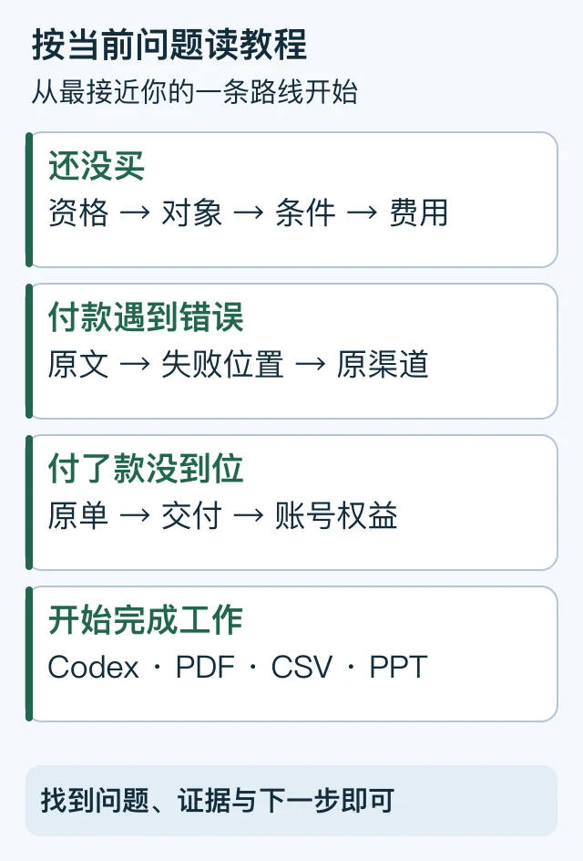

> 本文是[主稿](https://github.com/hyai-dev/ai-subscription-guide/blob/main/docs/17-guide-reading-map.md)的稳定归档，由 PayForGPT 与 Nano Banana 内容运营方维护。原稿发表：2026-10-19；复核：2026-10-19。修订原稿后同步本文件，不按日期重复增加文章数。

# awesome ChatGPT Plus guide阅读地图：从问题找到来源和下一步

首次发布与复核：2026-10-19。由 PayForGPT 与 Nano Banana 内容运营方维护。

## 搜到一个公开指南仓库，先看什么？

“awesome-chatgpt-plus-guide”一类名字通常是教程索引或资源整理的命名方式，不自动表示官方认证、独立测评或所有步骤已实测。先看维护者、复核日期、来源与具体问题，再按下面路线阅读。

文字路线：购买前 → 付款异常 → 交付验收 → 实际使用；按当前任务进入，不必通读全部文章。[SVG源](../assets/keyword-tasks-20261019/guide-task-routes.svg)

## 路线一：还没买，想知道怎么买才合适

1. 用[购买对象说明](../docs/03-plus-without-card.md)分清订阅、余额和第三方商品。
2. 涉及银行卡时，看[地区与发卡行核对](../docs/11-domestic-card-payment.md)。
3. 比较商家时，填写[平台选择表](../docs/15-provider-selection.md)，不只按起价排序。
4. 有旧订阅，先看[原渠道与续费状态](../docs/06-renewal-and-price-comparison.md)。

完成标准：能说清楚买什么、交付到哪里、适用条件、完整费用与原单入口；说不清就先补问题。

## 路线二：正在付款，遇到拒付或转圈

先记录错误原文与是否有扣款，再按[绑卡失败分支](../docs/12-card-binding-failed.md)找原平台或银行。已经出现付款记录时，优先查原单，不连续重新付款。

完成标准：明确哪一步失败、谁处理、原付款是否仍有待核对状态；不能仅凭“跳回页面”判定成功。

## 路线三：付过款，想查交付与权益

先看[已付款仍是Free](../docs/14-paid-but-still-free.md)，按付款、交付、兑换、账号、周期分开验收。有问题时使用[工单模板](../docs/13-support-ticket-query.md)，把必要材料脱敏，不发送登录凭证。

完成标准：每个已完成状态有对应证据；未完成状态有处理方与下一步。

## 路线四：开始用工具完成工作

- [Codex小任务](../docs/07-codex-first-task.md)：固定输入、修改范围、检查与diff。
- [PDF证据表](../docs/08-pdf-evidence-workflow.md)：结论能返回原页，不编页码。
- [CSV核算](../docs/09-spreadsheet-audit-workflow.md)：保留原始输入、分流和可重算总计。
- [PPT大纲](../docs/10-presentation-outline-workflow.md)：每页一个结论，数字有来源。

这些有合成练习与验收标准，不表示所有账号都具备相同功能或我们完成了模型效果评测。

## 五分钟判断一篇教程是否值得照做

| 观察项 | 你可以检查的内容 |
| --- | --- |
| 维护者 | 是否说明与商业站点的关系 |
| 时间 | 初次发表、后续复核与历史状态是否分开 |
| 来源 | 规则是否能回到相关官方文档，而非只引另一篇软文 |
| 操作 | 是否交代准备、预期结果和失败后的下一步 |
| 材料 | 是否让你公开发送验证码、会话或其他秘密 |
| 证据 | 原稿、归档、公开链接、实测、搜索收录是否混淆 |

GitHub公开文件可供阅读、版本追溯和反馈；星标、提交频率与归档数不能替代流量或订单证据。[GitHub仓库流量说明](https://docs.github.com/en/repositories/viewing-activity-and-data-for-your-repository/viewing-traffic-to-a-repository)

本仓库的[README](../README.md)是短入口，本篇展开阅读路线。[官方付款帮助](https://help.openai.com/en/articles/7232916-why-was-my-credit-card-declined)仍是处理官方规则的原始来源之一。发现错误可按[贡献流程](../CONTRIBUTING.md)提交不含敏感信息的更正。

---

相关资料：[PayForGPT对应任务帮助](https://payforgpt.com/how-to?utm_source=github&utm_medium=referral&utm_campaign=ai_subscription_guide_guide_reading_map_payforgpt#open-source-recharge-guides) · [Nano Banana对应任务帮助](https://nano-banana.lol/ai-subscriptions/search-intent?utm_source=github&utm_medium=referral&utm_campaign=ai_subscription_guide_guide_reading_map_nano#github-guide-index)。链接指向我们运营的网站；商品、支付和交付条件以实际页面为准。
