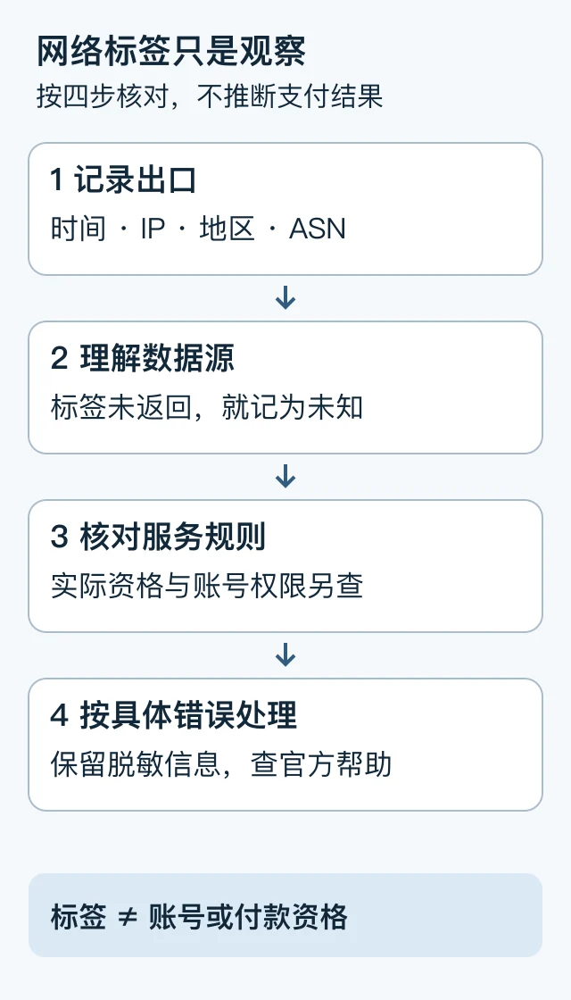

> 本文是[主稿](https://github.com/hyai-dev/ai-subscription-guide/blob/main/docs/01-ip-check-tutorial.md)的稳定归档，由 PayForGPT 与 Nano Banana 内容运营方维护。原稿发表：2026-10-14；复核：2026-10-19。修订原稿后同步本文件，不按日期重复增加文章数。

# IP 网络信息怎么读：地区、ASN 与第三方标签分别核对

首次发布：2026-10-14；复核：2026-10-19。本文由 PayForGPT 与 Nano Banana 内容运营方维护。本轮确认工具页面公开可访问，没有测试任何账号的登录或付款成功率。

## 30 秒先看结果

IP 检测帮助记录当时的出口网络和数据库标签。**标签不能证明账号资格、服务地区资格或付款会通过。**住宅、移动、机房、代理是不同属性，不按“干净程度”排列。



图解的等价步骤：“记录出口 → 理解标签 → 核对服务规则 → 按具体报错处理”。[可编辑 SVG](../assets/network-review-20261019/network-check.svg)

## 第一步：记录实际观察

打开 [Nano Banana IP 网络信息工具](https://nano-banana.lol/ip)，查看字段、数据来源和隐私说明。只查询你有权使用的网络，不提供账号密码、会话或账单。

记录时间、出口 IP、地区、ISP/ASN 和返回标签。字段缺失或请求失败就写“未知”，不把未返回的标签解释成“不是代理”。

| 字段 | 能说明什么 | 不能据此推导什么 |
| --- | --- | --- |
| 出口 IP | 本次请求对外呈现的网络地址 | 所有设备或应用使用同一出口 |
| 地区 | 数据库对地址的地理标注 | 本人实际地区或平台服务资格 |
| ISP / ASN | 网络运营或自治系统信息 | 账号可信度、付款通过率 |
| proxy / hosting 标签 | 数据源的网络分类 | 平台内部风控结论、是否会封号 |

IP-API 分别定义 `proxy`、`hosting`、`mobile` 字段；它们不是平台认证。[字段说明](https://ip-api.com/docs/api:json)

## 第二步：用合成记录练习

下面使用文档示例地址，不是实际检测结果：

```text
出口：192.0.2.10
地区：数据库显示的某地区
ASN：某网络自治系统
hosting：true
proxy：未返回
```

正确解读：数据源标记了托管网络，代理字段未知。不能因此认定账号异常、本人位于该地区或支付会通过。两次查询不同，先核对时间、设备、网络和数据源。

可复制排查模板：

```text
目标服务与具体报错：
设备、网络与发生时间：
出口信息（公开分享时隐藏不必要的完整IP）：
数据源、已返回与未知字段：
已查的官方资格和排错页面：
已核实的观察：
仍需服务商协助的事项：
```

## 第三步：回到服务规则与具体错误

保留脱敏的错误文字与时间，核对目标平台的支持地区、账号和真实账单资料要求。需要时找网络服务商确认出口，或联系目标平台。不能通过伪造所在地、账单地址或反复更换出口，把检测结果当作资格证明。

查询页 HTTP200 只说明页面可访问。购买前看[资格与购买对象](../docs/03-plus-without-card.md)；已付款先查[原渠道和账单](../docs/05-payment-channels-and-billing-records.md)。

## 本次更正与来源

旧版“住宅最干净”“新号第一印象”和从单一标签推断中转的断言已移除。Git 历史保留用于追溯，以复核后主稿为准。

2026-10-19 实际读取：[工具页面](https://nano-banana.lol/ip)、[IP-API JSON 文档](https://ip-api.com/docs/api:json)。未做真实账号或支付测试。

---

相关资料：[Nano Banana网络信息工具](https://nano-banana.lol/ip?utm_source=github&utm_medium=referral&utm_campaign=ai_subscription_guide_network_check_nano)。链接指向我们运营的网站；商品、支付和交付条件以实际页面为准。
