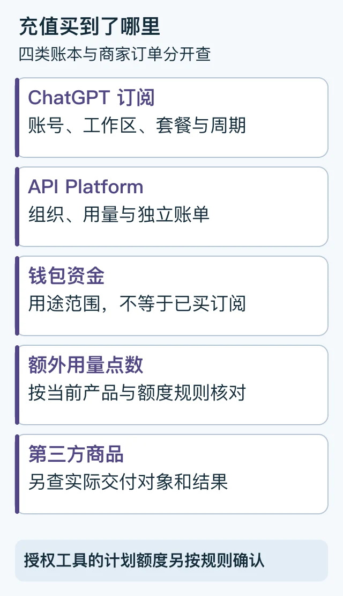

> 本文是[主稿](https://github.com/hyai-dev/ai-subscription-guide/blob/main/docs/18-membership-api-wallet.md)的稳定归档，由 PayForGPT 与 Nano Banana 内容运营方维护。原稿发表：2026-10-19；复核：2026-10-19。修订原稿后同步本文件，不按日期重复增加文章数。

# ChatGPT会员、API余额和用量点数：购买前找对账单

首次发布与复核：2026-10-19。由 PayForGPT 与 Nano Banana 内容运营方整理。

## 先问：这笔钱究竟买到了哪里？

“ChatGPT充值”可能指订阅、API Platform用量、钱包资金、额外用量点数，或某个第三方商品。先确定**收款方、账单入口、权益对象和当前余额/用量类型**，不能只看“充值成功”。



图解：四个账本分别核对，不能把一个余额截图当成全部产品开通。[SVG源](../assets/keyword-tasks-20261019/billing-object-map.svg)

## 先把购买对象填进表格

| 对象 | 主要核对什么 | 不能直接推导什么 |
| --- | --- | --- |
| ChatGPT订阅 | 本人账号/工作区、套餐、周期和原渠道 | 自己API Platform账户同时获得余额 |
| API Platform / API key用量 | API组织、用量、预算及独立账单 | 当前ChatGPT界面已经升级会员 |
| 钱包余额 | 钱包类型、可用范围及消费规则 | 已购买订阅或增加额外用量点数 |
| 额外usage credits | 当前产品、用途与用量规则 | 与钱包资金或API账单任意互换 |
| 第三方商城商品 | 商品名称、交付对象和实际结果 | 商家字段就是官方账单或官方礼品卡 |

OpenAI的Plus说明将API Platform用量与ChatGPT订阅分开。钱包文档也明确，加资金本身不等于购买订阅或增加usage credits。[Plus与API计费](https://help.openai.com/en/articles/6950777-what-is-chatgpt-plus)、[钱包余额](https://help.openai.com/en/articles/20001508-using-your-chatgpt-wallet-balance)

## 登录方式也要单独看

本地Codex的ChatGPT登录与API key登录有不同计费、权限和数据管理路径；官方登录和价格说明应与本人客户端相互核对。[Authentication](https://learn.chatgpt.com/docs/auth)、[Pricing](https://learn.chatgpt.com/docs/pricing)

也不要把“所有采用API形式的请求都一定另收API费用”当通则。合资格工具若支持官方Sign in withChatGPT并经本人批准使用计划额度，应按该授权和当前官方规则确认。[官方合资格工具与计划额度](https://developers.openai.com/siwc/token-sharing-open-source)说明该授权路径；[会话与授权管理](https://developers.openai.com/siwc/token-sharing-open-source/profiles-and-sessions)另说明凭证处理与断开方式。它与把原始Session、Cookie交给商家是不同的操作，不能由一个“免密”标签推导安全或计费结果。

## 可复制的购买前确认单

```text
准备购买的准确商品：
收款方与实际账单入口：
目标账号、工作区或API组织：
对应的是订阅 / API用量 / 钱包 / usage credits / 商家材料：
币种、周期、用途限制与完整费用：
付款后到哪里看实际权益：
原有订阅或余额是否仍独立存在：
```

## 用两个合成情形检查理解

**情形A：API调用成功，ChatGPT仍是Free。** 先看API组织和ChatGPT账号各自的账单；API调用成功不单独证明买了ChatGPT会员。

**情形B：钱包显示有资金，套餐没变化。** 钱包加资与订阅购买不是同一动作，应按钱包规则及原购买记录核对，不再向不明“激活入口”转账。

这些是解释用的虚构情形，没有实际调用API或操作钱包。

## 常见问题

**ChatGPT Plus包含自己API key的费用吗？** 官方将API Platform用量单独计费，不能把Plus付款当API余额充值。

**点数、钱包和会员能按一比一换算吗？** 不凭名称换算；先查该产品的计费单位、用途和规则。

**商家卡密一定是官方礼品卡吗？** 要看具体商品与来源证据，不能凭“卡密”两个字认定。

购买前可继续看[平台比较表](../docs/15-provider-selection.md)；已付款但结果不一致，走[五个状态验收](../docs/14-paid-but-still-free.md)。本文未做充值、兑换、API或钱包实测。

---

相关资料：[PayForGPT对应任务帮助](https://payforgpt.com/ai-subscriptions/chatgpt-payment-channels-guide?utm_source=github&utm_medium=referral&utm_campaign=ai_subscription_guide_membership_api_wallet_payforgpt) · [Nano Banana对应任务帮助](https://nano-banana.lol/ai-subscriptions/alipay-wechat-pay?utm_source=github&utm_medium=referral&utm_campaign=ai_subscription_guide_membership_api_wallet_nano)。链接指向我们运营的网站；商品、支付和交付条件以实际页面为准。
