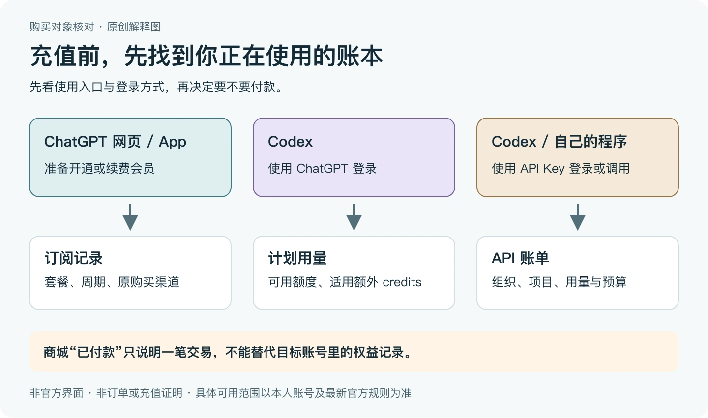

> 本文是[主稿](https://github.com/hyai-dev/ai-subscription-guide/blob/main/docs/18-membership-api-wallet.md)的稳定归档，由 PayForGPT 与 Nano Banana 内容运营方维护。原稿发表：2026-10-19；复核：2026-10-25。修订原稿后同步本文件，不按日期重复增加文章数。

# ChatGPT会员、API余额和用量点数：购买前找对账单

首次发布：2026-10-19；最近复核：2026-10-25。由 PayForGPT 与 Nano Banana 内容运营方整理。两站均是独立商家，下面的自有站链接不属于第三方推荐；本文不接收账号凭证、充值或付款。

## OpenAI 额度充值：先确认缺的是哪一种

网页里没有 Plus、Codex 提示用量不足、程序返回余额不足，可能需要处理三个不同的账本。**先看你正在用什么、怎样登录；不要先买一张写着“GPT充值”的商品。**



图是运营方原创解释图，不是官方界面、真实账户或到账证明。[可缩放SVG](../assets/billing-activation-20261025/three-billing-routes.svg)。

| 现在卡在哪里 | 先看哪里 | 先别做什么 |
| --- | --- | --- |
| ChatGPT 网页或 App 中仍是 Free，想开会员 | 当前账号/工作区、套餐及原购买渠道 | 不用 API 余额截图证明会员开通 |
| Codex 通过 ChatGPT 登录，提示当前用量不足 | Codex 的用量页面；CLI可用时查看 `/status`，再按本人计划确认可用选项 | 不把 Plus/Pro 月卡当作额外 credits 商品 |
| 自己程序或 Codex 使用 API Key，遇到额度/账单错误 | 该 Key 所属 API 组织、项目、用量和账单；错误还要结合实际代码分辨 | 不先升级 ChatGPT 会员来修复 API 账单 |
| 商家商品只写“额度”“点数”而没有产品名 | 要求卖家说清充值对象、登录方式和核验入口 | 不根据关键词或头像猜它是 OpenAI 官方余额 |

官方 [Authentication](https://learn.chatgpt.com/docs/auth) 区分了 ChatGPT 登录的订阅访问与 API Key 登录的按量访问；[Pricing](https://learn.chatgpt.com/docs/pricing) 也分别说明计划用量、适用额外 credits 和 API 计费。具体可用选项与当前账号、计划和官方规则有关，不能用一份固定的“次数表”替所有人判断。

## 一个可复用的排查顺序

1. **辨认入口。** 是 ChatGPT、Codex 客户端，还是调用 API 的程序？“都用 OpenAI”不是同一账本的证据。
2. **看登录方式。** 对 Codex 尤其重要：ChatGPT 登录与 API Key 登录要分开核对；不要把 Key 或 Session 贴到公开求助帖。
3. **对准账号和组织。** 核对本人当前工作区；API 场景还要确认 Key 所属组织/项目，而不是看到任意一个有余额的账号就结束。
4. **记录实际提示。** “用量限制”“付款失败”“权限不足”分别处理；只有账单明确需要补充资金时，才讨论对应账本的付款。
5. **核验结果。** 目标页面实际的套餐、可用用量或 API 账单是否变化？商家“已付/已发货”只作为交易记录，不能代替这一步。

这份检查清单可以直接复制到自己的笔记里；不需要把填好的资料发到本仓库：

```text
我正在使用的入口：ChatGPT / Codex / 自己的API程序
登录方式：ChatGPT / API Key / 尚未确认
需要处理的对象：订阅 / 计划用量 / 额外credits / API账单
本人账号、工作区或API组织是否已经核对：是 / 否
看到的实际提示（先删除敏感内容）：
付款前准备在哪个页面核验结果：
尚缺哪项信息，需要原渠道确认：
```

## 先问：这笔钱究竟买到了哪里？

“ChatGPT充值”可能指订阅、API Platform用量、钱包资金、额外用量点数，或某个第三方商品。先确定**收款方、账单入口、权益对象和当前余额/用量类型**，不能只看“充值成功”。


图解：四个账本分别核对，不能把一个余额截图当成全部产品开通。[SVG源](../assets/keyword-tasks-20261019/billing-object-map.svg)

## 先把购买对象填进表格

| 对象 | 主要核对什么 | 不能直接推导什么 |
| --- | --- | --- |
| ChatGPT订阅 | 本人账号/工作区、套餐、周期和原渠道 | 自己API Platform账户同时获得余额 |
| API Platform / API key用量 | API组织、用量、预算及独立账单 | 当前ChatGPT界面已经升级会员 |
| 钱包余额 | 钱包类型、可用范围及消费规则 | 已购买订阅或增加额外用量点数 |
| 额外usage credits | 当前产品、用途与用量规则 | 与钱包资金或API账单任意互换 |
| 第三方商城商品 | 商品名称、交付对象和实际结果 | 商家字段就是官方账单或官方礼品卡 |

钱包、商家余额与特定产品的额外 credits 也不能只凭名称互换。遇到这些名称时，先查看该产品当下的使用范围与规则；没有核验就保留“尚未确认”。

## 登录方式也要单独看

本地 Codex 的 ChatGPT 登录与 API Key 登录有不同计费、权限和数据管理路径；官方登录和价格说明应与本人客户端相互核对。本文没有为你切换登录方式，也没有读取或验证任何 Key。

同样，不要仅凭“请求长得像 API”判断账单。先辨认工具实际采用的登录与授权方式，再按对应产品规则核对；“免密”标签也不能单独证明授权范围、凭证处理或计费结果。

## 可复制的购买前确认单

```text
准备购买的准确商品：
收款方与实际账单入口：
目标账号、工作区或API组织：
对应的是订阅 / API用量 / 钱包 / usage credits / 商家材料：
币种、周期、用途限制与完整费用：
付款后到哪里看实际权益：
原有订阅或余额是否仍独立存在：
```

## 用两个合成情形检查理解

**情形A：API调用成功，ChatGPT仍是Free。** 先看API组织和ChatGPT账号各自的账单；API调用成功不单独证明买了ChatGPT会员。

**情形B：Codex使用ChatGPT登录，提示用量不足。** 先查该计划的当前用量与可用选项；不要跳到API组织里看到有余额，就认定这次登录会自动使用它。

这些是解释用的合成情形，没有实际调用 API、操作账号或完成充值。

## 常见问题

**ChatGPT Plus包含自己API key的费用吗？** 官方将API Platform用量单独计费，不能把Plus付款当API余额充值。

**点数、钱包和会员能按一比一换算吗？** 不凭名称换算；先查该产品的计费单位、用途和规则。

**商家卡密一定是官方礼品卡吗？** 要看具体商品与来源证据，不能凭“卡密”两个字认定。

购买前可继续看[平台比较表](../docs/15-provider-selection.md)；已付款但结果不一致，走[五个状态验收](../docs/14-paid-but-still-free.md)。本文未做充值、兑换、API或钱包实测。

## 如果你正在看我们的商品

PayForGPT 与 Nano Banana 的当前 ChatGPT 卡密/订阅商品，**不能按名称当作 API 余额充值或 Codex 额外 credits**。需要这两种产品的人应先按官方账单与本人资格核对，不能用一张会员月卡替代。

| 需要进一步核对什么 | 运营方自有说明 |
| --- | --- |
| API 模型访问、余额与账单错误怎样分流 | [Nano：OpenAI额度与API错误核对](https://nano-banana.lol/ai-subscriptions/openai-api-model-access-billing-errors?utm_source=github&utm_medium=referral&utm_campaign=ai_subscription_guide_billing_k96_nano) |
| ChatGPT会员、API账单与Codex用量买到哪里 | [PayForGPT：额度充值前的账单判断](https://payforgpt.com/how-to/chatgpt-subscription-vs-api-billing?utm_source=github&utm_medium=referral&utm_campaign=ai_subscription_guide_billing_k96_payforgpt) |

链接带有站点与主题来源标记，不代表已产生访问、订单或独立推荐。本文复核的是官方规则与公开说明，没有执行付款、兑换或 API 调用。

---

相关资料：[Nano额度与API错误核对](https://nano-banana.lol/ai-subscriptions/openai-api-model-access-billing-errors?utm_source=github&utm_medium=referral&utm_campaign=ai_subscription_guide_billing_k96_nano) · [PayForGPT额度充值账单分流](https://payforgpt.com/how-to/chatgpt-subscription-vs-api-billing?utm_source=github&utm_medium=referral&utm_campaign=ai_subscription_guide_billing_k96_payforgpt)。链接指向我们运营的网站；商品、支付和交付条件以实际页面为准。
