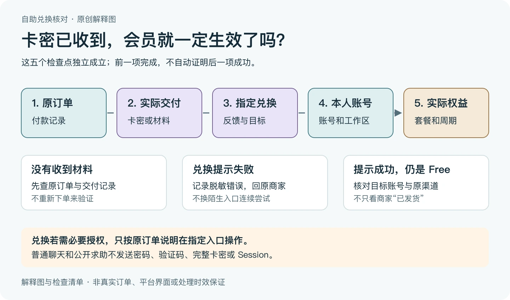
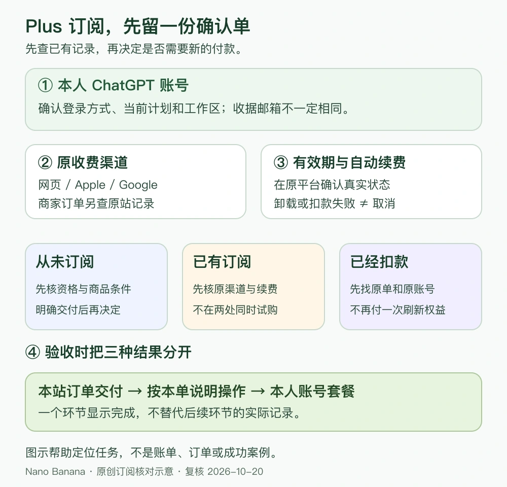
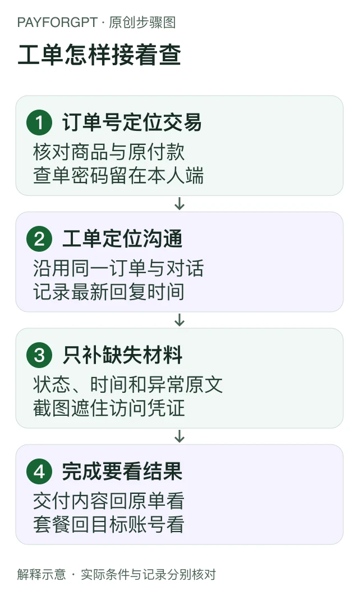

> 本文是[主稿](https://github.com/hyai-dev/ai-subscription-guide/blob/main/docs/14-paid-but-still-free.md)的稳定归档，由 PayForGPT 与 Nano Banana 内容运营方维护。原稿发表：2026-10-19；复核：2026-10-25。修订原稿后同步本文件，不按日期重复增加文章数。

# ChatGPT已付款仍显示Free：分开核对付款、交付与权益

首次发布：2026-10-19；最近复核：2026-10-25。由 PayForGPT 与 Nano Banana 内容运营方整理。两站均是独立商家，自有站链接不属于独立第三方推荐；本文不接收卡密、账号授权或付款。

## 别把“付了钱”和“买在这个账号”合成一个判断

先找原付款记录，再检查实际交付、兑换反馈和当前账号。最小验收对象是：**哪个渠道、哪个订单、哪个账号及工作区、什么套餐与周期。**出现不一致时先留证，不重复付款。


等价顺序：付款 → 交付 → 兑换 → 账号 → 套餐周期。[SVG源](../assets/keyword-tasks-20261019/paid-free-states.svg)

## 先选你遇到的情况

| 当前看到什么 | 直接查哪一段 | 暂停哪种操作 |
| --- | --- | --- |
| 钱扣了，交付材料没找到 | [付款、交付两行](#status-check) | 暂停重下单、再付款 |
| 卡密拿到了，兑换提示失败 | [兑换一行](#status-check)，保留错误原文 | 暂停换入口、连续重试 |
| 兑换提示成功，账号仍是 Free | [账号与工作区](#account-check)，再核对周期 | 不把清缓存当成升级证明 |
| 账号本来就是 Plus，想确认这笔续费 | [已经是 Plus](#renewal-check)一节 | 不凭一个 Plus 标识判定续费成功 |
| iOS 提示关联另一个账号 | [iOS 关联排查](#ios-check)一节 | 不反复换号购买 |

<a id="account-check"></a>

## 第一步：确认当前账号和工作区

确认你正在看的账号，与购买或交付约定的账号一致。再核对当前工作区、套餐页面和原渠道收据。不在公开工单贴完整身份信息，用必要且脱敏的材料沟通。

先在仍能正常使用订阅的设备查看 ChatGPT 账号和登录方式。**收据收件邮箱可能与 ChatGPT 登录邮箱不同**，不能只按收件箱猜账号。跨设备核对时回到原购买账号；移动端购买仍由原商店管理。[OpenAI跨设备使用说明](https://help.openai.com/en/articles/8980438-can-i-access-my-chatgpt-subscription-from-another-device)

若实际买到了另一账号，不能直接把订阅“转过来”。官方说明 ChatGPT订阅不能在不同账号间转移，应按原渠道和官方帮助处理。[订阅不能跨账号转移](https://help.openai.com/en/articles/9135236)

<a id="status-check"></a>

## 第二步：按五个状态查缺口

| 检查点 | 要看到的证据 | 仍不能单独证明什么 |
| --- | --- | --- |
| 付款 | 原渠道明确的付款记录 | 商家已交付、账号已升级 |
| 交付 | 本商品约定的材料或交付记录 | 已正确兑换到目标账号 |
| 兑换 | 实际兑换反馈及目标说明 | 当前界面一定已显示完整权益 |
| 账号 | 正确账号及工作区 | 周期、档位都符合购买约定 |
| 权益 | 账号内实际套餐、周期及对应记录 | 其他账号也获得同一订阅 |

如果是官方直接购买，没有商家卡密或兑换步骤，就按该渠道实际流程跳过不适用项，不人为制造一个“必须有卡密”的环节。

<a id="card-code-activation-check"></a>

## 卡密收到后，怎样完成自助激活而不漏一步？

如果实际买的是“发兑换卡密，按指引自行激活”的商品，商家发货只是交付了材料。下面检查的是从材料到权益的路径，不是替你的账号执行兑换。



运营方原创解释图，非真实订单或成功率证明。[可缩放SVG](../assets/billing-activation-20261025/card-code-result-check.svg)。

1. **从原订单取材料。** 使用原下单邮箱、订单号和查单密码进入受保护的订单页；确认商品与交付内容。不要把完整卡密或查单密码贴进公开评论。
2. **先读适用条件。** 原有套餐、原订阅渠道、账号与地区条件、有效期起算及售后，按这件商品逐项确认。看到“月卡”不能自行理解成所有账号统一再延长30天。
3. **只从原订单进入兑换。** 核对原订单指引的地址、商品及目标账号后，再提供该流程明确需要的材料。不要在陌生“补单/激活”页面尝试。
4. **授权需求先解释再操作。** 部分商品确需 Session/Token 等授权时，应由该商品在指定兑换入口说明用途和处理方，再由本人决定操作；这不等于全站“绝不需要授权”，也不等于普通客服聊天可以索取密码、邮箱验证码或恢复码。
5. **回到目标账号核对结果。** 兑换反馈、本人账号/工作区、实际套餐与周期要对应同一笔约定。只有卡密、只有“已发货”、只有成功提示，都不能替代完整核对。

| 做到哪里停住了 | 先保存什么 | 找谁处理 |
| --- | --- | --- |
| 原订单没有交付材料 | 原订单状态与缺少哪项材料 | 原商家订单支持，不重新付款 |
| 指定入口提示卡密/条件错误 | 错误原文的脱敏版本、商品和操作阶段 | 原商家核对，不在多站连续试卡密 |
| 兑换提示成功，仍为Free | 正确账号/工作区、套餐显示、对应周期差异 | 按原渠道和商品约定处理，不把刷新或清缓存当到账证据 |
| 已有Plus，看不出本次续费 | 本次订单和原周期/原渠道记录 | 先核对下节的续费条件，不重复购买验证 |

这些步骤不把商家卡密认定成 OpenAI 官方礼品卡，也不表示我们已验证你的会员。与原购买无关的平台看不到这笔第三方订单，应回原处理方。

<a id="renewal-check"></a>

## 已经是 Plus，怎么确认这笔续费生效？

“账号有 Plus”只说明现在存在这项权益。如果付款前就已经有会员，这个标识不能单独证明本次续费。应核对**同一账号、原订阅渠道、对应订单及这次约定的套餐周期**；有续费记录或新的周期信息时，一并对照。没有可对照的记录，就先记“尚未确认”，交给原订单处理方核实。



图：运营方自有解释图，帮助拆分检查对象；不是官方产品界面、真实订单或到账证明。

| 你能确认的事实 | 可以得出的结论 | 还需要补什么 |
| --- | --- | --- |
| 付款前后都显示 Plus | 账号当前有会员 | 本次订单对应的周期与交付记录 |
| 商家订单显示已交付 | 商家记录了一次交付 | 实际兑换反馈及目标账号 |
| 账号和周期都与本次约定一致 | 已具备进一步核验的材料 | 如仍有差异，按原订单留证处理 |

不要自行假设续费一定叠加、一定立即起算或统一延长30天；这些要看本商品明确条件与原渠道实际记录。拿不到对应记录时先联系原处理方，不通过再买一次来“验证”。

## 第三步：根据原渠道处理

- **官方网页**：保留收据与账号状态，用官方帮助处理付款与权益差异。
- **Apple / Google**：到原商店确认订阅与付款。需要恢复购买时按原平台指引操作，不把恢复动作称为跨账号转移。
- **第三方商品**：先确认交付对象到底是卡密、原账号服务还是其他商品，再在原订单核对。
- **API或钱包**：余额、点数或API调用可用，不等于ChatGPT会员已升级，见[账单与余额区别](../docs/18-membership-api-wallet.md)。

切换渠道前还要检查旧订阅。官方特别说明 Apple 的失败续费不代表自动取消，后续可能重试；另开订阅可能导致重复收费。[避免多渠道重复收费](https://help.openai.com/en/articles/20001043-how-do-i-avoid-being-charged-twice-if-i-subscribe-to-chatgpt-on-ios-android-and-the-web)

<a id="ios-check"></a>

## iOS 提示“订阅关联到另一个账号”时

这里要分别确认 **Apple 购买账户**和**当时登录的 ChatGPT 账号**。同一部手机或同一个 Apple ID，不代表当前所有 ChatGPT 账号都获得这份订阅。先找回原来购买时的 ChatGPT 账号；App 中的“恢复购买”用于核对原来的购买，不是把订阅搬到另一个账号。

[OpenAI的账号关联排查](https://help.openai.com/en/articles/20001056-why-am-i-seeing-a-message-that-my-subscription-is-associated-with-another-account)与[恢复App Store购买说明](https://help.openai.com/en/articles/8346573-restoring-a-chatgpt-subscription-purchased-in-the-apple-app-store)给出相应支持路径。账号无法找回、收据与权益不符时，联系原收费方或官方支持；不要在陌生第三方页面或公开求助中粘贴购买凭证、会话或验证码。

### 完整示例一：Apple有订阅，当前ChatGPT仍是Free

**合成案例，不是用户订单、平台界面截图或成功率证明。**“账号A/B”只是说明不同登录对象，没有真实邮箱。

| 记录项 | 示例中看到的状态 | 下一步 |
| --- | --- | --- |
| 原购买渠道 | Apple App Store | 在Apple原订阅记录中确认是否仍有效 |
| 原购买时ChatGPT登录 | 账号A | 回到账号A核对，无法登录时先处理账号恢复 |
| 当前App登录 | 账号B，显示Free | 当前显示不能证明账号A没有权益 |
| 恢复购买反馈 | 提示关联另一个账号 | 按官方关联排查，不把恢复理解成跨账号转移 |
| 处理对象 | 原账号归属/原渠道支持 | 暂停在账号B重复购买；保存脱敏差异描述 |

这个例子的完成条件是“原账号、原渠道记录与套餐周期对上”，不是“多试几个账号直到显示会员”。如果自己的情况不同，按实际反馈记录，不能套用示例结论。

### 完整示例二：商家订单已交付，兑换结果仍未知

**合成案例。**某数字商品订单显示“已交付”，读者只看到了交付材料，还没有核对其适用条件和入口。此时可以填写：

```text
原购买渠道：原商家网站
付款记录：显示已付，尚未与账号权益对应核验
交付记录：订单显示已交付，具体材料已在原订单内查看
兑换反馈：尚未确认，不写“已成功升级”
当前账号/工作区：已核对为本人目标账号
实际套餐：仍显示Free
需要原商家核对：材料对应的商品、适用账号条件和正确操作入口
```

这类情况回原商家订单查交付约定，不直接让OpenAI核对第三方卡密，也不把“已交付”当成“已升级”。

可以下载[已填写的合成核对表](../assets/quality-repair-20261020/subscription-evidence.example.csv)，保留结构、删除示例行后在自己设备上记录。表格不需要密码、完整卡密、Session、订单查询密码或支付账号信息。不要把自己填完的材料提交到公开仓库。

## 把问题交给正确的处理方



图：运营方自有流程图，不是真实客服对话或处理时效承诺。第三方卡密和商家交付先找原商家；官方直接购买的账号或收费差异按原渠道、官方支持路径处理。普通聊天与公开求助不发送账号密码、完整卡密、会话凭证或验证码；确需兑换材料的，在原订单指定入口按说明提交，不把两种场景混在一起。

公开求助时只写状态与脱敏错误。确需订单号、收据等核对材料，应按原渠道受保护的支持流程提交，不发到公开评论、GitHub Issue 或陌生验证页面。

## 可复制的空白验收记录

```text
原购买渠道与订单：
付款记录状态：
实际交付对象与记录：
兑换反馈（如适用）：
当前账号/工作区是否正确：
实际套餐、周期与购买约定：
不一致的具体一项、需要哪个处理方核对：
```

## 常见问题

**已发货但没升级，先做什么？** 先看发货材料与商品说明，再核对兑换、账号及周期，不单看“已发货”三个字。

**退出再登录一定能到账吗？** 不能保证；显示刷新不是付款或交付的证据。

**我原来就有Plus，看到Plus是不是这单已到账？** 不是充分证据。对照本次订单、目标账号及约定周期；对应不上就记尚未确认。

**多久没变化就该再付？** 没有一个通用时间可支持重复付款。按原订单状态和已确认的处理时间跟进。

需要联系原商家时，直接使用[工单问题模板](../docs/13-support-ticket-query.md)。本文没有查询真实订单或操作账号。

## 原商家订单的后续帮助

若原订单来自本仓运营方，可按自己遇到的问题进入对应说明；其他渠道购买请回原收款方：

| 原商家 | 卡密购买到激活的自助路径 | 购买前的代升级条件核对 |
| --- | --- | --- |
| Nano Banana | [自助充值的起点与原订单](https://nano-banana.lol/guide?utm_source=github&utm_medium=referral&utm_campaign=ai_subscription_guide_activation_k97_k98_nano) | [代升级交付与必要授权](https://nano-banana.lol/ai-subscriptions/chatgpt-plus-recharge?utm_source=github&utm_medium=referral&utm_campaign=ai_subscription_guide_activation_k97_k98_nano) |
| PayForGPT | [购买、查卡密和自助激活](https://payforgpt.com/guide?utm_source=github&utm_medium=referral&utm_campaign=ai_subscription_guide_activation_k97_k98_payforgpt) | [代升级适用条件与交付对象](https://payforgpt.com/how-to/recharge-chatgpt-plus?utm_source=github&utm_medium=referral&utm_campaign=ai_subscription_guide_activation_k97_k98_payforgpt) |

这些是同一运营方维护的帮助页，带主题与站点来源标记；不代表独立推荐、已产生访问或任何订单成功。本文新增的是检查流程与图解，没有查询真实订单、提交授权或完成兑换。

---

相关资料：[Nano自助激活路径](https://nano-banana.lol/guide?utm_source=github&utm_medium=referral&utm_campaign=ai_subscription_guide_activation_k97_k98_nano) · [Nano代升级条件核对](https://nano-banana.lol/ai-subscriptions/chatgpt-plus-recharge?utm_source=github&utm_medium=referral&utm_campaign=ai_subscription_guide_activation_k97_k98_nano) · [PayForGPT自助激活路径](https://payforgpt.com/guide?utm_source=github&utm_medium=referral&utm_campaign=ai_subscription_guide_activation_k97_k98_payforgpt) · [PayForGPT代升级条件核对](https://payforgpt.com/how-to/recharge-chatgpt-plus?utm_source=github&utm_medium=referral&utm_campaign=ai_subscription_guide_activation_k97_k98_payforgpt)。链接指向我们运营的网站；商品、支付和交付条件以实际页面为准。
