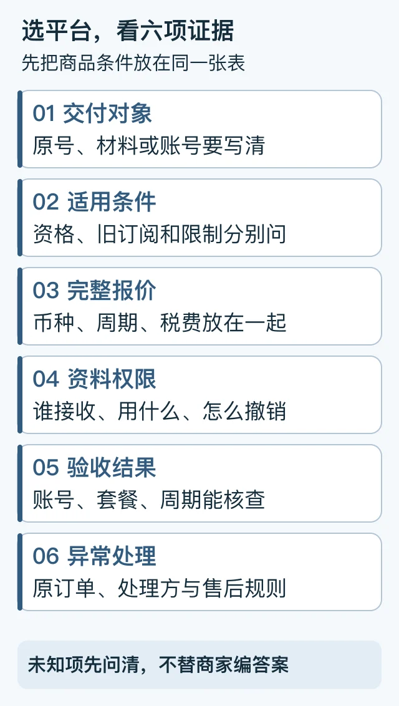

> 本文是[主稿](https://github.com/hyai-dev/ai-subscription-guide/blob/main/docs/15-provider-selection.md)的稳定归档，由 PayForGPT 与 Nano Banana 内容运营方维护。原稿发表：2026-10-19；复核：2026-10-19。修订原稿后同步本文件，不按日期重复增加文章数。

# ChatGPT充值哪个平台好：按交付类型、条件和售后比较

首次发布与复核：2026-10-19。由 PayForGPT 与 Nano Banana 内容运营方维护；这是一张选择核对表，不是独立第三方测评榜单。

## 先把“推荐哪个平台”变成六个能核对的问题

先明确交付到哪里、适用什么条件、费用怎么算、需要交什么材料、怎样验收、异常找谁处理。同一套条件核对清楚后，再比较价格与服务。



图中文字就是可填写的核对顺序，不按品牌作无依据排名。[SVG源](../assets/keyword-tasks-20261019/provider-evidence-grid.svg)

## 六项比较表

| 项目 | 购买前要问什么 | 合格的记录方式 |
| --- | --- | --- |
| 交付对象 | 原账号服务、兑换材料还是另一账号？ | 记具体商品及目标账号要求 |
| 适用条件 | 地区、旧订阅、客户端或账号有哪些限制？ | 记录来源与未知项，不自行补齐 |
| 完整报价 | 什么币种、周期、税费、手续费和续费规则？ | 同周期同权益比较，低至价另列 |
| 资料要求 | 谁接收、要什么、用途和撤销方式是什么？ | 普通订单材料与账号凭证分开 |
| 验收结果 | 怎样确认交付与目标账号的套餐周期？ | 明确可检查的结果 |
| 异常处理 | 付款核对、交付异常、退款各由谁处理？ | 保留原订单入口与具体规则 |

卡密发货、原号服务和共享账号不是同一种交付。OpenAI账号面向创建者本人使用，不能把多人共享同一凭证称为独立个人账号。[账号使用政策](https://help.openai.com/en/articles/10471989-openai-account-sharing-policy)

## 用合成案例练习比较

| 报价 | 已知信息 | 还不能得出的结论 |
| --- | --- | --- |
| A：某币种每月报价，原账号服务 | 周期与交付对象清楚，含税未知 | 不能直接算出最终总价 |
| B：较低起价，交付材料未说明 | 只知道广告起价 | 不能判断比A便宜或更适合 |
| C：余额额度报价 | 是余额产品，周期未说明 | 不能与ChatGPT月度订阅直接排序 |

三条都是虚构示例。公开页面的报价观察也需要同样核对：见[8源价格观察](../data/prices/latest.md)。该表不证明实际结算价或独立履约能力，缺币种/周期的记录不强行换算。

## 可复制的选型记录

```text
我的需求与目标账号：
来源URL与观察时间：
具体商品、周期、币种、税费与完整应付：
交付类型与适用条件：
资料接收方、必要材料、撤销或安全说明：
成功验收的具体标准：
原订单查询、售后及退款条件：
未知项与购买前要问的一个问题：
```

实体SIM和开票可以作为附加需求，但要核对具体供给与条件；未知不代表竞品没有，SIM也不是账号防封保证。商业invoice、国内税务发票和报销要求分别确认。

## 常见问题

**ChatGPT代付平台推荐看什么？** 看与你的需求相关、能核对的交付与售后证据；先问清未知项，再决定。

**“免密”能当安全指标吗？** 还要看是否要求Cookie、Session或其他凭证，见[风险承诺核对](../docs/16-account-risk-claims.md)。

**便宜很多，可以先买再问吗？** 先认清商品对象、周期与适用条件。买错对象通常不能靠另一笔付款修复。

关于官方付款资格，见[国内信用卡核对](../docs/11-domestic-card-payment.md)。本文未进行真实交易横评，没有平台成功率或排名结论。

---

相关资料：[PayForGPT对应任务帮助](https://payforgpt.com/ai-subscriptions/chatgpt-recharge-platform-selection?utm_source=github&utm_medium=referral&utm_campaign=ai_subscription_guide_provider_selection_payforgpt#platform-comparison-checklist) · [Nano Banana对应任务帮助](https://nano-banana.lol/ai-subscriptions/compare?utm_source=github&utm_medium=referral&utm_campaign=ai_subscription_guide_provider_selection_nano#recharge-platform-choice)。链接指向我们运营的网站；商品、支付和交付条件以实际页面为准。
