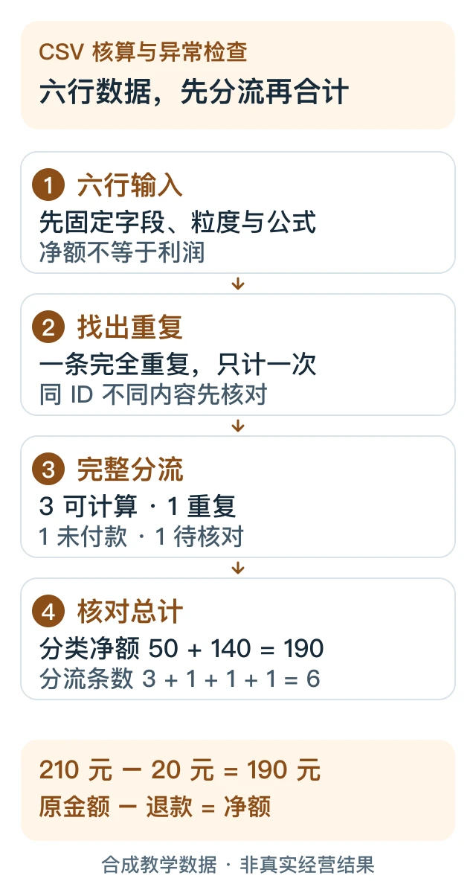

> 本文是[主稿](https://github.com/hyai-dev/ai-subscription-guide/blob/main/docs/09-spreadsheet-audit-workflow.md)的稳定归档，由 PayForGPT 与 Nano Banana 内容运营方维护。原稿发表：2026-10-19；复核：2026-10-19。修订原稿后同步本文件，不按日期重复增加文章数。

# 用 ChatGPT 核对 CSV：先定口径，再查重复、缺失与合计

复核日期：2026-10-19。本文使用原创虚构 CSV，给出可独立重算的答案；没有真实订单、顾客信息或模型性能结论。

## 30 秒先看结果

把一张六行 CSV 分成“可计算、重复、不计入、待核对”四类，再核对金额。这个样例的正确答案是：**3 条有效记录，原金额 210.00 元，退款 20.00 元，净额 190.00 元。**

官方表格工作流建议先约定关联键、重复处理和指标定义，保留原始导出，将无法匹配或存在冲突的记录列出来。[官方表格合并指南](https://learn.chatgpt.com/use-cases/consolidate-spreadsheets)

## 准备条件

- [下载合成 CSV](../assets/practical-20261019/sample-sales.csv)，也可以复制下方内容。金额单位统一为人民币元；它不代表任何网站的真实经营数据。
- 保留原文件副本，先在副本或新输出中分析。
- 当前可用的文件/数据工具。没有上传功能时可粘贴六行数据；没有代码执行时可用表格软件或下方本地校验器复核，不把模型口头计算视为已执行。



图解：六行应完整分流为“3 条可计算 + 1 条完全重复 + 1 条未付款 + 1 条数量缺失”，不能默默丢行。[可编辑 SVG](../assets/practical-20261019/csv-audit-flow.svg)

## 步骤 1：把口径写在数据前面

本练习约定：每一行代表一条记录，`record_id` 为唯一键；完全相同的重复记录保留一次；同 ID 不同内容要停下来核对。只有 `paid` 且数量、单价、退款完整的记录计入；缺失不能自动补零。单条净额为 `quantity × unit_price − refund_amount`，先统一币种再合计。

```csv
record_id,category,status,quantity,unit_price,refund_amount
S001,guide,paid,2,25.00,0.00
S002,template,paid,1,80.00,20.00
S003,guide,unpaid,3,25.00,0.00
S004,template,paid,1,80.00,0.00
S002,template,paid,1,80.00,20.00
S005,guide,paid,,25.00,0.00
```

真实数据可能是一行一个商品、支付事件或退款事件，不能直接套用这个唯一键与公式。先检查粒度、币种和退款含义，再讨论去重。

## 步骤 2：要求先检查质量，再生成结果

可复制提示词：

```text
分析这份CSV，先复述字段、每行粒度、金额单位和规则，再计算。
本样例：record_id唯一；整行完全重复保留一次；同ID不同内容列为冲突并停止出正式合计。
只计paid且quantity、unit_price、refund_amount完整的记录；缺失不能补零。
净额=quantity*unit_price-refund_amount；不推断利润、税额或真实业务表现。
输出：输入行数、完全重复清单、冲突/缺失清单、排除原因、逐行计算、分类小计、总计。
保留原CSV，输出到新文件；说明用了什么工具/代码和哪些检查实际执行。
不能执行计算或看不到全部数据时如实说明，提供公式与待核对项。
最后证明“全部输入行数=各处理类别行数之和”，并检查分类净额等于总净额。
```

## 步骤 3：逐条验收，不只看漂亮图表

| 处理类别 | 行/记录 | 原因或金额 |
|---|---|---|
| 可计算 | S001 | `2×25−0=50.00` |
| 可计算 | S002 首次出现 | `1×80−20=60.00` |
| 可计算 | S004 | `1×80−0=80.00` |
| 完全重复 | S002 第二次出现 | 排除 1 行 |
| 不计入 | S003 | 未付款，排除 1 行 |
| 待核对 | S005 | 数量缺失，排除 1 行；不推断数量 |

预期结果为：`6=3+1+1+1`；原金额 `50+80+80=210`；退款 `0+20+0=20`；净额 `190`。分类净额 `guide=50`、`template=140`，相加仍为 `190`。这些都是样例规则下的结果，“净额”也不等于利润。

## 步骤 4：用独立算法复核

仓库附带[标准库校验器](../assets/practical-20261019/verify-sample-sales.py)与[预期结果](../assets/practical-20261019/sample-sales-expected.json)。下载 CSV 和校验器到同一文件夹，在已安装 Python 3 的终端运行：

```bash
python3 verify-sample-sales.py sample-sales.csv
```

校验器使用十进制定点数，输出分流计数、逐行金额、分类与总计。它只支持本练习定义的字段及规则；它不是通用财务审计工具，也不会发送网络请求。

编辑发布时已对仓库样例运行该校验器，并核对了以上计数与金额。**这仅验证示例的确定性计算，没有验证任何模型在真实 Excel 上的准确率。**

## 卡住时怎么处理

| 情况 | 下一步 |
|---|---|
| 同一 ID 对应不同金额 | 保留冲突行，核对来源；不能“保留最后一条”来掩盖冲突 |
| 金额带币种符号或千位逗号 | 先明确格式和币种，记录转换规则，抽样核对原值 |
| 数量、日期或退款缺失 | 建待核对清单，不凭常识补齐 |
| 合计与分类不一致 | 回看逐行纳入/排除、过滤范围、隐藏行和公式引用 |
| 只有摘要，没有逐行依据 | 要求返回分流表和公式，再决定是否接受 |

需要汇报时，继续看[把核对后的数据整理成演示大纲](../docs/10-presentation-outline-workflow.md)。

## 官方来源与适用范围

- [Consolidate spreadsheets](https://learn.chatgpt.com/use-cases/consolidate-spreadsheets)：事先定义规则，保留导出和异常清单，复核结果。
- [Work with files](https://learn.chatgpt.com/docs/artifacts-viewer)：明确工作表、列、图表及验收要求，打开输出检查。

以上官方正文已于 2026-10-19 读取。CSV、公式、脚本和预期结果均为原创教学材料；功能与权限以当前账号界面为准。
