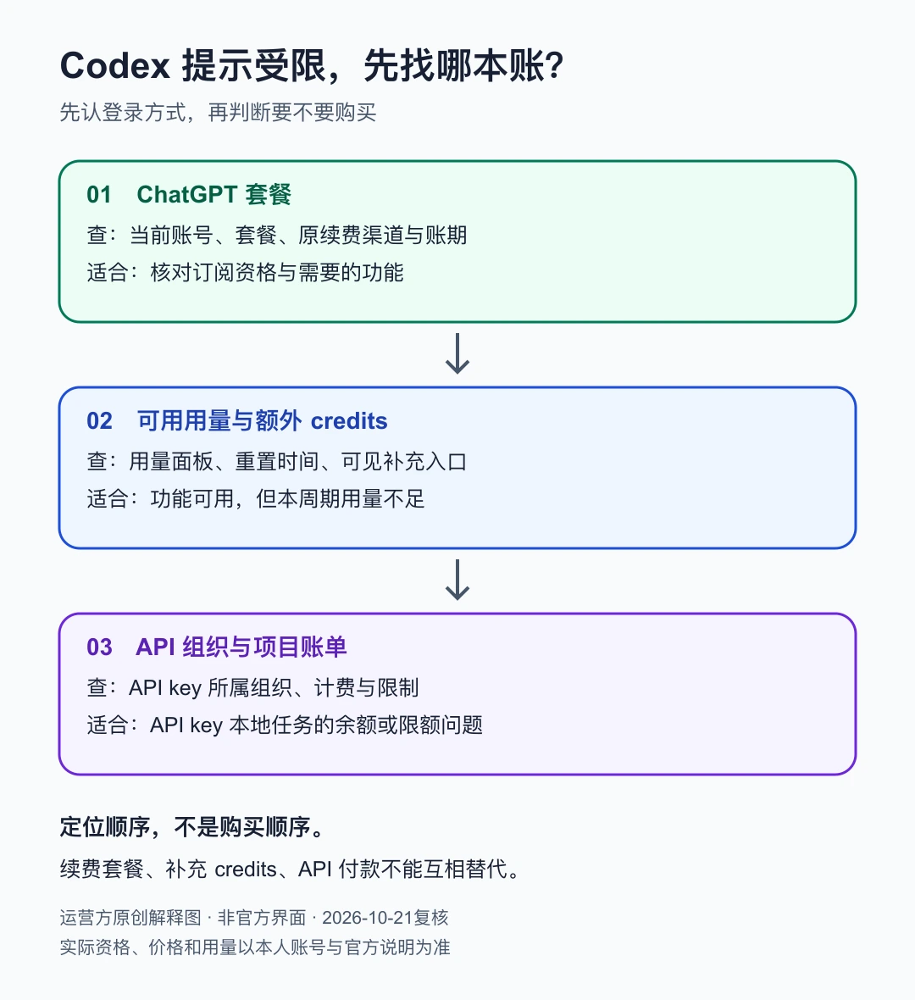
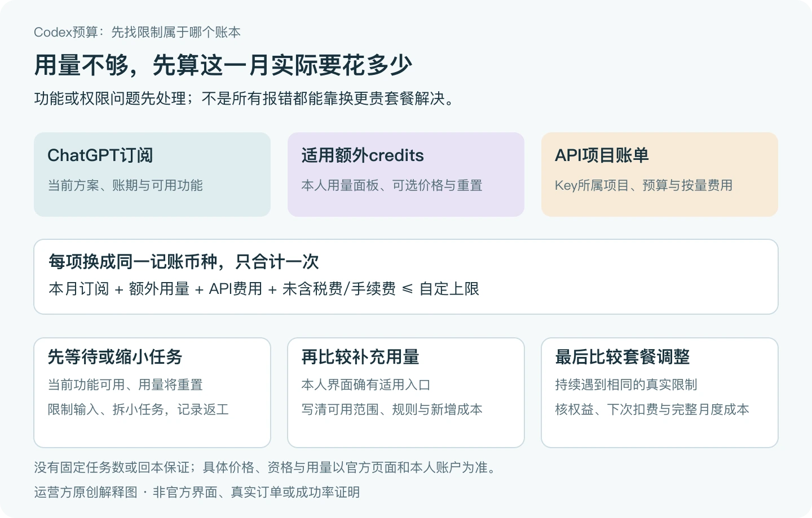

# Codex 购买前先核对：登录方式、当前可用功能与实际用量

首次发布：2026-10-14；最近复核：2026-10-25。由 PayForGPT 与 Nano Banana 内容运营方按 OpenAI Docs 公开资料整理。我们运营下文两个商业站，链接不属于独立第三方推荐；没有执行真实登录、充值或模型测试。

## 30 秒先看结果

先用当前可用账号确认功能和用量，再决定是否购买。**Codex 的 ChatGPT 登录与 API key 登录有不同的访问、计费与管理路径，“Codex充值”不能一概理解为买 Plus 或 Pro。**

官方说明本地 Codex 可使用 ChatGPT 或 API key 登录，云端 Codex 要求 ChatGPT 登录；具体客户端、工作区及功能权限分别核对。[官方登录说明](https://learn.chatgpt.com/docs/auth)


教学示意：付款、订阅权益和可用额度不是同一个状态。

## 第一步：认清当前登录与购买对象

| 当前情况 | 先确认什么 | 不能混淆的事项 |
| --- | --- | --- |
| ChatGPT 登录 | 本人账号、工作区、可见功能与用量 | 商家交付不等于目标账号已有权益 |
| API key 本地使用 | API 组织、计费、额度和管理员要求 | API 用量与 ChatGPT 订阅不是同一账单 |
| 企业或学校工作区 | 成员身份、角色、席位与开放功能 | 个人套餐不会自动改变组织授权 |
| 看不到某功能 | 客户端、开放范围、权限与官方说明 | 不直接推断必须买更贵套餐 |

当前价格与功能以[官方说明](https://learn.chatgpt.com/docs/pricing)和本人界面为准。这里不固化价格、固定任务次数或“多数人够用”的结论。

### 搜“Codex订阅”或“Codex Pro充值”，先对上这三本账



原创解释图，非官方截图；下面的表格提供相同信息。

| 你实际想解决什么 | 去哪里取数 | 下一步 |
| --- | --- | --- |
| 想订阅或调整个人套餐 | 本人ChatGPT套餐、原订阅渠道、下个账期 | 先比较需要的功能，再看是否需要调整套餐 |
| 已有套餐，但可用用量不足 | 本人用量面板显示的剩余量、重置时间及可购买credits入口 | 按当前账号可见选项判断等待、缩小任务或补充credits；不直接重复买月卡 |
| 用API key运行本地任务，提示余额或限额 | 对应API组织/项目的计费和限制页面 | 找API账单或组织管理员；续费ChatGPT套餐不能代替这一步 |

官方将ChatGPT登录的订阅访问、可用的额外credits与API key用量计费分别说明；具体可用选项取决于账号、客户端和工作区。套餐名称相同，也不能据此保证每位用户看到同样功能。[登录方式](https://learn.chatgpt.com/docs/auth)、[用量与credits](https://learn.chatgpt.com/docs/pricing)

“Codex Pro”不是本文替商家确认的官方独立商品名。看到5x、20x或“无限”等标签，先让卖方写清对应套餐、交付对象、有效期起算、适用条件和售后；不能拿一个倍率推导固定任务数。

## 第二步：记录真正的限制

选一个可核对的小任务，记录实际结果、用量提示和工具权限，区分代码环境、访问、额度和付款问题。

```text
登录路径：ChatGPT / API key / 组织提供的其他方式
客户端与工作区：
具体任务与当前可用功能：
实际报错或用量提示（不含凭证）：
已执行的检查与结果：
是否确有需要改变的权限、权益或额度：
```

### 两个已填写的判断例子

以下均为合成教学案例，不是真实订单或产品实测。

**例子A：套餐仍有效，编辑器却提示API余额不足。** 小林记录到自己使用API key登录，报错来自该API项目。此时先核对API组织和账单，不能因为已经买过Plus，就要求商家再发一张Plus月卡解决API余额。

**例子B：ChatGPT登录后，用量面板显示达到本周期限制。** 小周先保存界面上的限制名称和重置时间，检查当前账号有没有额外credits入口。若功能本身可用，只是本周期用量耗尽，就比较等待或补充用量的成本；不要把“再买月卡”当成默认答案。可用时，CLI会话中的`/status`也可用于查看剩余用量，具体以[官方用量说明](https://learn.chatgpt.com/docs/pricing)和本人界面为准。

这两个例子用同一条判断规则：**先找报错对应的账本，再决定处理付款、权限还是用量。**

可以先看[Codex 第一个小任务](07-codex-first-task.md)，用固定输入与预期练习验收，再决定是否购买。

<a id="codex-monthly-budget-check"></a>

## Codex用量不够，怎样决定等、补用量还是调整套餐？

先分清是功能没开放、组织权限不足，还是某个用量确实耗尽。前两种，未必能靠多付一次钱解决。官方[用量与价格说明](https://learn.chatgpt.com/docs/pricing)建议查看本人用量面板；CLI可用时查看`/status`。当前额度、可购买选项和重置时间以自己的界面为准，不把别人的“能跑多少次”当预算依据。



运营方原创解释图，不是官方用量界面、实际账单或回本证明。[可缩放SVG](../assets/final-plan-20261025/codex-budget-decision.svg)。

| 目前确认的情况 | 先比较的选项 | 付款前多记一项 |
| --- | --- | --- |
| 当前功能可用，只是用量将到上限 | 等待重置，或收窄任务和输入材料 | 下个重置时间、任务能否分批完成 |
| 本人界面提供适用的额外credits | 该选项的用途、价格和使用规则 | 它适用于哪个账本、完整新增成本；不要把会员卡密当作credits |
| 连续多次遇到同一种用量限制 | 当前方案与其他可用方案的完整成本和功能 | 新账期、改档扣费和权益；不能仅凭5x/20x推固定产出 |
| 使用API Key，报项目余额或限额 | 该API组织/项目的账单及管理员设置 | 本项目预算、用量和权限；不重复买ChatGPT月卡 |

### 把总预算写在付款之前

先选一个自己的记账币种，再逐项记录：**本月订阅支出＋额外用量支出＋实际使用的API费用＋尚未包含的税费/手续费**。已含在报价里的费用不要重复加；不同币种先记录来源和当次换算，未知的费用留空，不能按零元算。

**合成例子：**你给本月AI工具定了300元上限，已确认支出260元，剩余40元。若新增支出预计60元，合计320元，就超出20元；这时可以延后不急的任务或重新分配预算。所有数字都是算账练习，不对应任何套餐、credits或商家报价，也没有实际付款。

```text
我这个月的总预算与记账币种：
现在用ChatGPT登录还是API Key；对应的账本：
已确认的订阅、额外用量、API和未含费用（分别列行）：
待核费用及来源，不填0替代未知：
当前限制名称、本人界面的重置时间或可选入口：
不再花钱时，哪些任务仍能完成：
增加支出后需要补足的具体需求：
最终应付、下一账期和停止继续加购的上限：
```

本次改档的实际应付与下一账期续费请分开记录；同一期已经计入的费用不要再次相加。

你也可以连续记录几次同类任务的耗时、返工、用量提示与人工接手情况。记录不是为了给自己凑一个“必须升级”的理由：如果多数任务能在现有功能内完成，就先用现有方案；如果卡在代码环境或工具权限，先处理环境和权限。本文没有固定任务数、节省时间比例或升级回本保证。

需要核对会员、credits和API的区别，直接用[三类账单分流](18-membership-api-wallet.md)；遇到“不限量”“防封”承诺，看[购买风险的六项证据](16-account-risk-claims.md#recharge-risk-evidence)。这两篇是同一仓库的不同问题入口，不是新的付费商品。

## 第三步：确需购买时，比较完整条件

核对商品、账号归属、交付对象、周期、币种税费、资格、原续费状态和售后。付款方式以实际结算页为准，不泛称所有渠道均支持微信或 USDT，也不由商家收款方式推导官方服务资格。

已有订单先查原订单，不重复付款。订单材料、付款确认、商家交付和账号实际权益分别验收。查单密码保存在自己的可信位置，不贴到公开 Issue 或教程截图。客服核单先提供订单号和脱敏材料。

密码、验证码、Cookie、Session JSON、API key 不作为普通客服备注或核单材料。免密码不等于没有凭证访问风险，见[凭证与订单证据](04-account-credentials-and-order-evidence.md)。

## 第四步：按问题找下一步

- 访问问题：回本人账号与当前官方功能/权限说明核对。
- 已扣款或续费失败：看[付款渠道与账单](05-payment-channels-and-billing-records.md)、[续费状态](06-renewal-and-price-comparison.md)。
- 我们两站的分工入口：[PayForGPT当前Codex账本指南](https://payforgpt.com/codex?utm_source=github&utm_medium=referral&utm_campaign=codex_check_payforgpt)、[Nano Banana同周期用量预算](https://nano-banana.lol/blog/is-chatgpt-pro-worth-it-for-codex-users-2026?utm_source=github&utm_medium=referral&utm_campaign=codex_check_nano#section-4-w3maei)。两站由同一运营方经营；PFG补充交易和激活，Nano补充选购预算。它们不是第三方独立推荐，原订单仍回原站点处理。

## 本次更正与来源

已删除旧版“Codex本质总是买ChatGPT订阅”、未经测量的套餐适用推断，以及“地区稳定账号就安静”的说法。保留路径避免旧引用失效，历史稿不作为当前建议。

2026-10-21重新读取[Authentication](https://learn.chatgpt.com/docs/auth)、[Pricing](https://learn.chatgpt.com/docs/pricing)，补充三账本分流、已填写案例与双站任务入口。原URL、首次发表日和旧图保留。本文不创建API key或调用API，不替代平台资格与账单规则。

2026-10-25再次复核相同官方登录和用量来源，补等待/补用量/套餐调整的判断表、完整月度预算和空白记录；没有实测额度、价格或回本率。原稿路径与首次发表日不变。
