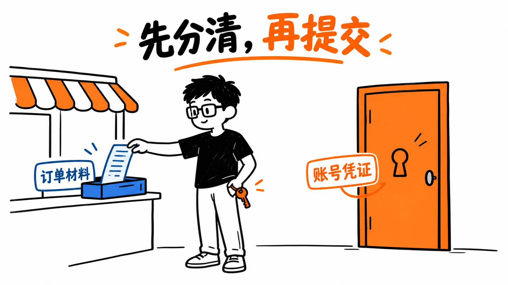

# 免密代充要交什么？先把订单材料和账号钥匙分开

资料复核：2026-10-18。本文由 PayForGPT 与 Nano Banana 内容运营方整理。我们是独立商家，与 OpenAI、Apple、Google 没有隶属关系。以下是依据公开规则写成的购买核对指南，没有实际提交私人凭证或测试任意商家的后台。

看到“不用密码”时，还要继续问：对方实际会收到什么？密码只是登录资料的一种，会话 Cookie、Session JSON 中的访问令牌等也可能带来账号访问风险。文件看起来像普通文字，或者里面没有聊天正文，都不足以证明只会用于付款。

*图 1：教学示意。纸质订单材料与账号钥匙代表两类权限，图中不含真实凭证，也不是任何平台的操作界面。*

## 先识别资料代表的权限

| 资料 | 用来判断什么 | 提交前应做什么 |
| --- | --- | --- |
| 商城订单号、金额、付款时间 | 查找某一笔订单 | 在原商城查单，按必要范围脱敏 |
| 账号邮箱 | 区分账号或接收订单通知 | 核对用途；通知邮箱不自动等于订阅账号 |
| 密码、一次性验证码、恢复资料 | 登录或恢复账号 | 在本人可信设备和官方流程中处理 |
| Cookie、完整 Session JSON、访问令牌 | 可能关联已登录会话或特定权限 | 不当作普通核单材料；先明确来源、范围与接收方 |
| API Key | 接口调用及相应用量费用 | 单独保管；不能用网页退出代替密钥撤销 |

具体能力取决于凭证类型和权限范围。不能把上表理解为所有令牌都具有相同能力，也不能从“短期有效”推导出没有泄露风险。OpenAI 的账号分享规则说明，个人账号面向创建者本人，向别人提供登录资料还涉及账号规则和误用风险。[账号分享政策](https://help.openai.com/en/articles/10471989-openai-account-sharing-policy)、[API Key 安全](https://help.openai.com/en/articles/5112595-best-practices-for-api-key-safety)。

## 提交前问清四件事

1. **接收方是谁？** 是原收款商城、其明确列出的服务方，还是陌生个人或不相关域名？
2. **用途与权限是什么？** 普通查单为何需要登录资料？若解释含糊，先停止提交。
3. **处理方式能否核对？** 保存、共享、保留期限和撤销方式需要具体说明；一句“用完就删”不是已验证的删除证明。
4. **交付如何验收？** 保存订单说明、价格、周期和售后条件；付款、订单完成和本人账号权益显示分别检查。

官方 OAuth 或特定工具的授权登录，与把整个会话文件交给任意商家不同。某个网站出现“ChatGPT 登录”字样，不足以证明该商家的订阅办理获得 OpenAI 授权。判断授权应看真实登录域名、应用身份、同意页、范围与撤销入口，不照着客服话术推断。

## 已经提交资料，下一步按资料类型处理

先保留脱敏的时间线和沟通记录。不要再次转发原密码、完整 JSON、二维码或验证码来“证明已经发过”。

怀疑账号异常时，按 OpenAI 安全指引修改适用的密码、检查安全活动、退出已有会话并联系支持。开启 MFA 不会自动注销旧会话；其他 ChatGPT 会话退出可能需要最长 30 分钟。若泄露的是 API Key，要另外撤销密钥并检查项目用量；第三方应用授权也应单独管理。[账号安全](https://help.openai.com/en/articles/8304786-keeping-your-openai-account-secure)、[MFA 说明](https://help.openai.com/en/articles/7967234-managing-multi-factor-authentication-mfa)。

*图 2：核单先找原交易的收款方。商城的订单记录、应用商店收据和 OpenAI 网页账单各自查询；图中没有表示某地区一定能购买。*

账号安全处置之后，再回原商城处理订单争议。支付截图和必要的订单信息通常用于解释交易事实，但具体流程与受理资料应以原收款方说明为准，不能保证仅凭某一张截图就一定退款。

## 两站的进一步核对资料

以下是我们运营的网站内容，供读者对照，并非独立第三方推荐：

- [PayForGPT：免密办理、密码与 Session 资料核对](https://payforgpt.com/ai-subscriptions/passwordless-recharge-credentials)
- [Nano Banana：账号密码与会话凭证风险检查](https://nano-banana.lol/ai-subscriptions/passwordless-recharge-credentials)

配图为原创生成式教学插图；不含真实账号资料，不作为功能、删除机制或付款安全的实测证据。
