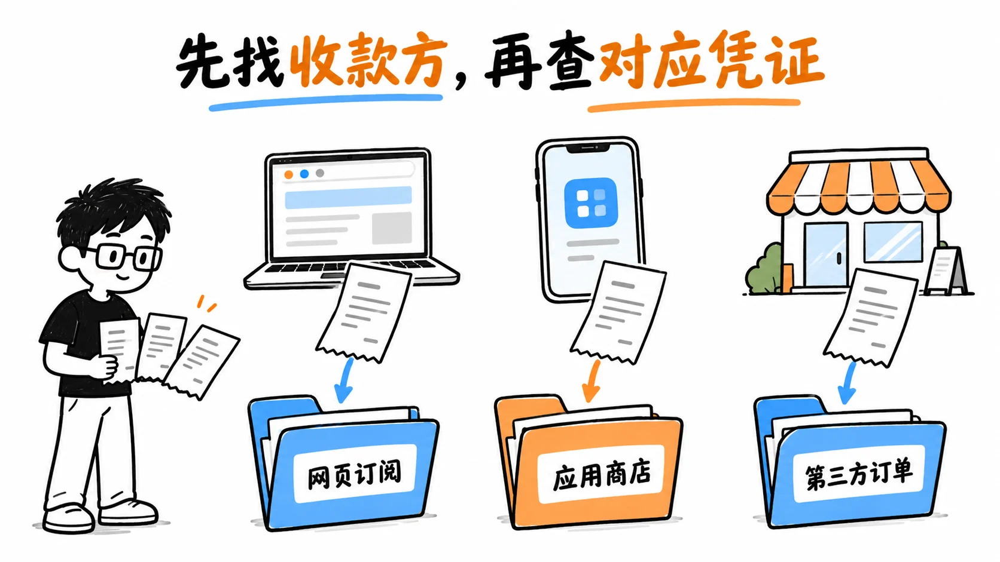
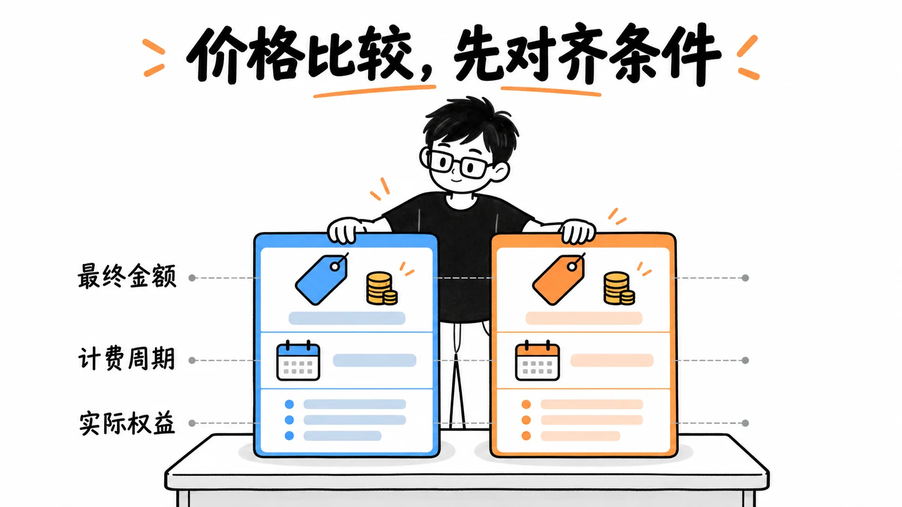

# ChatGPT 付款方式怎么核对：先认清买的是什么、谁在收款

资料复核：2026-10-18。由 PayForGPT 与 Nano Banana 内容运营方整理；两站是独立商家，与 OpenAI、Apple、Google 没有隶属关系。本文依据公开资料解释交易路径，没有进行真实付款或验证任何商家的充值成功率。

“能用人民币付款”“页面上有微信按钮”和“OpenAI 官方网页直接支持这种付款方式”是不同事实。判断一条付款路径，先写下购买对象、收款方、账号资格与原始凭证的位置，再看如何支付。

*图 1：教学示意。应用商店一栏还需进一步分清 Apple 和 Google；各自的订阅记录与客服流程不能混用。*

## 四类账单分别找入口

| 购买对象 | 先去哪里核对 | 不能据此推断什么 |
| --- | --- | --- |
| ChatGPT 网页订阅 | 本人 ChatGPT 账号的套餐、结账与账单管理 | 商城收据不能替代这一笔官方账单 |
| iOS 或 Android 应用内订阅 | 原 Apple 或 Google 账号的订阅、订单记录 | App 显示 Free 不自动证明原商店已取消续费 |
| OpenAI API 用量 | 本人的 API 组织、项目与账单 | Plus 月费不自动成为 API 余额 |
| 第三方商城商品 | 该商城的商品说明、订单、交付和售后 | 商家支持的付款方式不等于 OpenAI 原生支持或授权 |

OpenAI 的多币种说明区分网页结账和由 Apple／Google 管理的应用内订阅；具体币种和可用方式应查看本人当前结账页。[多币种计费](https://help.openai.com/en/articles/10421635-multicurrency-billing)。

## 先查服务地区和发卡资格，再检查卡片

OpenAI 的拒付排查说明要求核对本人所在地区与发卡银行地区是否受支持，并检查卡号、期限、安全码、真实账单地址和邮编、可用余额以及银行验证。卡上带有 Visa 或 Mastercard 标志、属于双币卡或曾支付其他海外网站，都不能单独证明这笔交易一定通过。[拒付原因与排查](https://help.openai.com/en/articles/7232916-why-was-my-credit-card-declined)。

中国大陆不在本次查阅的 ChatGPT 官方支持地区列表中。中文页面、人民币报价、换卡或购买海外实体 SIM 不会自动改变服务地区资格。不要编造免税州地址、税务身份或所在地来提交账单资料。[支持地区](https://help.openai.com/en/articles/7947663-chatgpt-supported-countries)、[不支持地区的服务说明](https://help.openai.com/en/articles/9131992-chatgpt-and-api-services-in-unsupported-countries-and-territories)。

符合相关资格后，仍应由本人按真实结账提示完成银行要求的验证。遇到拒付先确认原因，不把反复尝试、换浏览器或某个“专用卡段”当作一定能解决的问题。

## 商店付款列表不能跨地区套用

Apple 和 Google 的可用付款方式按国家、地区和账号条件区分。某个本地方式出现在 Apple 的某地区列表中，不证明 ChatGPT 在那个商店一定可售；也不能把应用商店的付款列表直接当成 chatgpt.com 网页结账选项。[Apple 地区付款方式](https://support.apple.com/en-us/111741)、[Google Play 付款方式](https://support.google.com/googleplay/answer/2651410?hl=en)。

第三方商城支持微信或支付宝，只说明该商城这一笔交易的收款安排。仍要核对具体 SKU、交付到哪个账号、资料条件和异常处理方式。不要仅从结算页的支付图标，推断上游授权、账号资格或交付已经得到确认。

## 比较价格时对齐同一笔交易

*图 2：没有填数字，因为币种、税费、周期和商品条件需要实时核对。两张卡并列不表示哪家更便宜或更安全。*

Plus 官方帮助页列明基准为每月 20 美元，但实际支付币种、税费和收款渠道需要分别查看。商家报价还可能对应不同交付与服务条件，不能把单一美元标价按固定汇率换成所有人的人民币终价，也不应编造“iOS 一律加价 30%”的表格。[Plus 说明](https://help.openai.com/en/articles/6950777-what-is-chatgpt-plus)。

付款前保留当时的商品页、最终金额、周期、接收方与退款边界；付款后先找对应渠道的原记录，再核对交付和本人账号显示的权益。

## 进一步资料

以下是两站运营方整理的流程说明，请结合官方规则和当前商品实际核对：

- [PayForGPT：ChatGPT 付款渠道与账单分流](https://payforgpt.com/ai-subscriptions/chatgpt-payment-channels-guide)
- [Nano Banana：支付宝、微信与订阅渠道核对](https://nano-banana.lol/ai-subscriptions/alipay-wechat-pay)

插图为原创教学示意，不是实际结账截图，不证明任何地区、卡片或商城已获批准。
