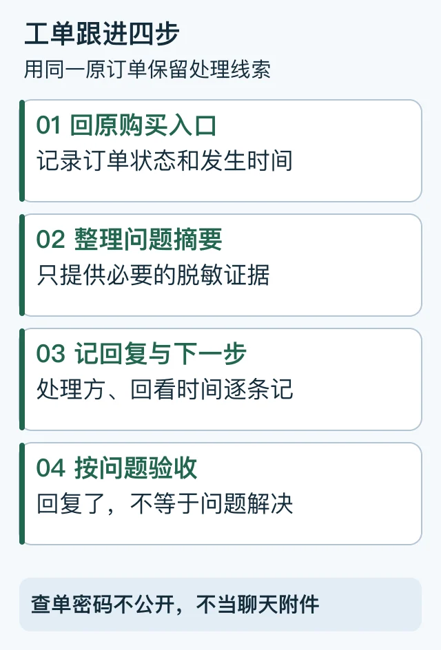

# ChatGPT代充工单查询：按原订单整理证据和回复

首次发布：2026-10-19；最近复核：2026-10-29。由 PayForGPT 与 Nano Banana 内容运营方整理。两站是独立商家，自有入口不属于独立第三方推荐。本文不接收订单、验证码或卡密。

钱付了，换台设备却找不到卡密时，先回原商家查同一笔订单。**忘记查单密码和没收到交付，是两个问题。** 前者先恢复查看权限，后者再按原单状态核对付款与发货；不靠重新买一笔“试试看”。

| 你手里还剩什么 | 先怎么做 | 需要停下来联系原商家的情况 |
| --- | --- | --- |
| 订单号、原查单密码都在 | 在原商家受保护的查单页输入，不发到公开评论 | 原单内容与付款记录不一致 |
| 有订单号，忘了密码，原下单邮箱能收信 | 原站若提供邮箱验证找回，按下文验证原邮箱 | 收不到邮件、提示不匹配或入口暂不可用 |
| 没有订单号，只有付款记录 | 整理购买时间、金额、收款方和原商品，交原商家核对 | 不要把支付流水号猜成商城订单号 |
| 能查单，也已收到卡密，但兑换失败 | 保存脱敏错误原文，从原订单指定入口求助 | 不把完整卡密贴进陌生“补单站”试错 |
| 兑换成功，目标账号仍不对 | 查账号、工作区、套餐与周期 | 不把“已发货”视为最终权益已验证 |

## 工单号、订单号和查单密码怎么分？

订单号用于定位购买记录；工单号通常用于定位客服问题。是否有独立工单系统，应看原商家的实际页面，不能由“工单查询”这个词推断存在某个入口。查单密码属于访问订单的材料，应自己保管，只在核实后的原商家私密查单表单输入，不贴到公开讨论或普通截图中。



文字顺序：原订单 → 问题摘要 → 脱敏证据 → 回复与下一步 → 验收。[SVG源](../assets/keyword-tasks-20261019/support-ticket-timeline.svg)

## 第一步：先回原购买入口

1. 从自己保存的购买记录进入原商家，核对域名。
2. 用该站实际提供的方式查原订单；不要在搜索到的陌生“查单站”输入材料。
3. 记下订单当前文字：待付款、核对中、已交付或其他状态。
4. 页面若有工单编号就记录；没有时，按原订单提供的客服入口联系。

找不到订单不等于没有扣款。先核对购买渠道、通知记录、下单时间与脱敏付款记录，再让原商家查找；不要重建一笔订单覆盖线索。

<a id="cross-device-order-recovery"></a>

## 换设备或忘记查单密码，怎么找回原单？

先区分三种信息：**商家下单邮箱、ChatGPT 登录账号、Apple/Google 商店账号。** 它们可能不同。找商家订单应使用原下单邮箱；确认订阅权益才回到正确的 ChatGPT 账号。OpenAI 的跨设备说明也提醒，收据收件邮箱不一定就是关联订阅的账号邮箱。[官方跨设备与账号关联说明](https://help.openai.com/en/articles/20001056-troubleshooting-subscriptions-linked-to-another-chatgpt-account)

以下是本运营方两站在 2026-10-29 的公开入口与功能核对，不代表其他商家也提供相同流程：

1. **进入原购买站点。** 在 Nano Banana 买的回 Nano，在 PayForGPT 买的回 PayForGPT。先核对域名，再打开订单查询；两站入口不同，不把查单材料到处试填。
2. **还能找到原密码时，先正常查单。** 订单号定位订单，查单密码保护交付材料。新设备不会因为登录了同一 ChatGPT 账号，就自动获得商家订单查看权。
3. **有订单号、能收原邮箱邮件时，展开“忘记查单密码？用原邮箱验证找回”。** 输入原订单号和原下单邮箱，发送验证码。页面的发送提示本身不能证明资料匹配或订单存在；以本人收信和后续验证结果为准。
4. **在原站私密表单填写邮件中的验证码。** 不发送给客服或第三方。验证通过后查看这一笔原订单；关闭页面后需要重新验证，原查单密码不会因此被改掉。跟随页面当前显示的有效期和重试提示操作。
5. **从订单状态继续检查交付。** 读到原单不等于发货已完成；收到卡密也不等于会员已激活。按原商品指引自行激活，必要时让原商家指导，再回正确账号核对套餐与周期。

没有收到验证码，先检查邮箱拼写、是否确为原下单邮箱、垃圾邮件与页面的等待提示。不要连续点击或猜验证码。如果不记得订单号、原邮箱不能再收信、页面暂不可用，转入原站的人工找回指南，使用下面的脱敏模板。**不能只凭一个邮箱或订单号，就公开展示完整卡密。** 邮箱恢复应验证接收能力；一次性凭据、有效期与尝试次数限制是访问保护的一部分。[OWASP 恢复流程说明](https://cheatsheetseries.owasp.org/cheatsheets/Forgot_Password_Cheat_Sheet.html)

### 两站的原单入口

以下是我们运营的网站，链接用于处理本人在对应站点的原订单：

- [Nano Banana：查询订单与原邮箱验证找回](https://nano-banana.lol/order?utm_source=github&utm_medium=referral&utm_campaign=order_recovery_nano)；[拿到卡密后的购买与激活指引](https://nano-banana.lol/guide?utm_source=github&utm_medium=referral&utm_campaign=order_recovery_nano)。
- [PayForGPT：查询订单与原邮箱验证找回](https://payforgpt.com/order?utm_source=github&utm_medium=referral&utm_campaign=order_recovery_payforgpt)；[付款、交付与自助激活指引](https://payforgpt.com/guide?utm_source=github&utm_medium=referral&utm_campaign=order_recovery_payforgpt)。

别把两站客服当作其他平台的查询代理；我们无法凭他站订单号读取或补发他站卡密。当前商品、可用入口和处理条件以原站实际页面为准。

### 一个跨设备例子

**下面是合成情境，没有使用真实订单或客户邮箱。** 小林在手机购买后关闭网页，晚上在电脑前只保留了订单号和原下单邮箱。此时应回原商家，先看是否仍能找到原密码；找不到但邮箱可收信时，使用该站的验证找回。若邮箱填成 ChatGPT 登录邮箱，而实际下单用了另一个邮箱，应该核对原下单资料，不能反复猜测。成功打开原单后，若订单仍是待付款，就把原付款时间与金额交给原商家核对；不要另买一单来替代核查。

## 第二步：发一个能被处理的问题

可复制模板，以下字段为占位说明：

```text
订单号：[已找到则填原订单号；找不到写“未找到”，不含查单密码]
问题类型：[付款未确认 / 未收到材料 / 兑换异常 / 权益未变化]
商品与购买时间：[按原记录填写]
原订单当前状态：[页面原文]
付款记录：[金额、时间、必要的脱敏识别信息]
已做的检查：[是否查过原站、是否能收原下单邮箱邮件、当前停在哪一步]
希望核对：[哪一步尚未完成，请确认处理方与下一步]
```

不要把密码、验证码、Cookie、完整 Session JSON 或 API key 加进这个模板。会话标识可能承载登录访问能力，不能当作普通核单附件。[OWASP会话说明](https://cheatsheetseries.owasp.org/cheatsheets/Session_Management_Cheat_Sheet.html)

## 第三步：把回复记成一条时间线

| 时间 | 实际发生的事 | 下一步 | 何时回看 |
| --- | --- | --- | --- |
| T1，合成示例 | 原单仍显示核对中 | 客服核对付款记录 | 按客服确认的时间 |
| T2，合成示例 | 客服要求补充脱敏时间信息 | 在原渠道补充必要字段 | 补充后记录回执 |
| T3，合成示例 | 原单更新为已交付 | 核对材料及目标账号 | 按商品说明验收 |

这些是教学示例，不是本站真实处理时限。没有承诺的时间就写“尚未确认”，不要替客服填写“几分钟完成”。

## 第四步：按问题本身验收

- 付款问题：原商家是否明确核对了该笔付款与原订单？
- 交付问题：是否收到本商品承诺的材料或结果？
- 权益问题：目标账号、工作区、套餐和周期是否符合购买约定？

“客服已回复”和“问题已解决”不是同一状态。继续核对[付款后仍是Free](14-paid-but-still-free.md)，或[订单材料与账号凭证](04-account-credentials-and-order-evidence.md)。

## 常见问题

**工单查询没有结果怎么办？** 确认编号来自原商家，再通过原订单联系；不要试用来历不明的查询入口。

**客服要验证码才能核单吗？** 普通订单核对不应把账号验证码当材料，先核对接收方与真正用途。

**商家显示交付了，等于Plus已到账吗？** 仍需看具体交付对象及本人账号结果。ChatGPT订阅也不能直接跨账号转移。[官方账号与订阅说明](https://help.openai.com/en/articles/9135236)

## 完成后，至少保留这四项

- 原购买站点及商品，避免下次从陌生搜索结果进入。
- 原订单号；查单密码单独安全保存，不放进公开截图。
- 原单的实际交付记录与本次处理结论，尚未解决的地方继续标明。
- 目标账号里与约定一致的套餐和周期，不把客服回复或发货提示替代最终验收。

本次读取了两站公开订单页、帮助页与邮箱恢复能力状态，并核对上述官方资料；没有访问私人订单、请求真实验证码、提交工单、付款、兑换或测试真实客服响应。公开入口可访问，不代表每个邮箱均能收信或每笔订单都已恢复。
