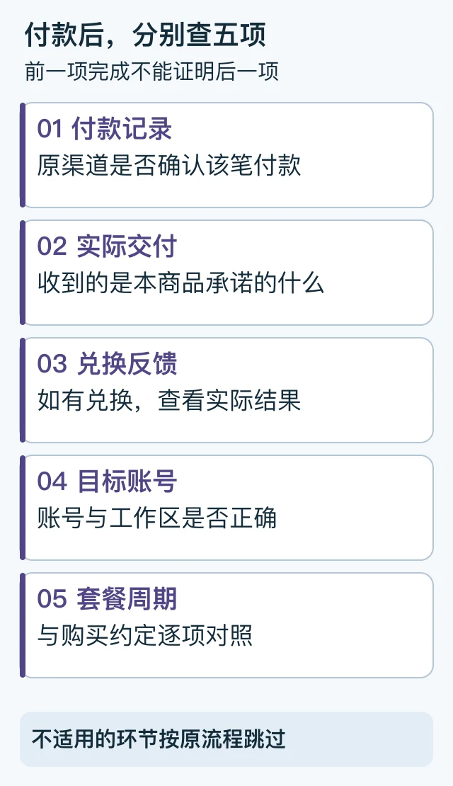

# ChatGPT已付款仍显示Free：分开核对付款、交付与权益

首次发布与复核：2026-10-19。由 PayForGPT 与 Nano Banana 内容运营方整理。

## 别把“付了钱”和“买在这个账号”合成一个判断

先找原付款记录，再检查实际交付、兑换反馈和当前账号。最小验收对象是：**哪个渠道、哪个订单、哪个账号及工作区、什么套餐与周期。**出现不一致时先留证，不重复付款。



等价顺序：付款 → 交付 → 兑换 → 账号 → 套餐周期。[SVG源](../assets/keyword-tasks-20261019/paid-free-states.svg)

## 第一步：确认当前账号和工作区

确认你正在看的账号，与购买或交付约定的账号一致。再核对当前工作区、套餐页面和原渠道收据。不在公开工单贴完整身份信息，用必要且脱敏的材料沟通。

若实际买到了另一账号，不能直接把订阅“转过来”。官方说明 ChatGPT订阅不能在不同账号间转移，应按原渠道和官方帮助处理。[订阅不能跨账号转移](https://help.openai.com/en/articles/9135236)

## 第二步：按五个状态查缺口

| 检查点 | 要看到的证据 | 仍不能单独证明什么 |
| --- | --- | --- |
| 付款 | 原渠道明确的付款记录 | 商家已交付、账号已升级 |
| 交付 | 本商品约定的材料或交付记录 | 已正确兑换到目标账号 |
| 兑换 | 实际兑换反馈及目标说明 | 当前界面一定已显示完整权益 |
| 账号 | 正确账号及工作区 | 周期、档位都符合购买约定 |
| 权益 | 账号内实际套餐、周期及对应记录 | 其他账号也获得同一订阅 |

如果是官方直接购买，没有商家卡密或兑换步骤，就按该渠道实际流程跳过不适用项，不人为制造一个“必须有卡密”的环节。

## 第三步：根据原渠道处理

- **官方网页**：保留收据与账号状态，用官方帮助处理付款与权益差异。
- **Apple / Google**：到原商店确认订阅与付款。需要恢复购买时按原平台指引操作，不把恢复动作称为跨账号转移。
- **第三方商品**：先确认交付对象到底是卡密、原账号服务还是其他商品，再在原订单核对。
- **API或钱包**：余额、点数或API调用可用，不等于ChatGPT会员已升级，见[账单与余额区别](18-membership-api-wallet.md)。

切换渠道前还要检查旧订阅。官方特别说明 Apple 的失败续费不代表自动取消，后续可能重试；另开订阅可能导致重复收费。[避免多渠道重复收费](https://help.openai.com/en/articles/20001043-how-do-i-avoid-being-charged-twice-if-i-subscribe-to-chatgpt-on-ios-android-and-the-web)

## 可复制的验收记录

```text
原购买渠道与订单：
付款记录状态：
实际交付对象与记录：
兑换反馈（如适用）：
当前账号/工作区是否正确：
实际套餐、周期与购买约定：
不一致的具体一项、需要哪个处理方核对：
```

## 常见问题

**已发货但没升级，先做什么？** 先看发货材料与商品说明，再核对兑换、账号及周期，不单看“已发货”三个字。

**退出再登录一定能到账吗？** 不能保证；显示刷新不是付款或交付的证据。

**多久没变化就该再付？** 没有一个通用时间可支持重复付款。按原订单状态和已确认的处理时间跟进。

需要联系原商家时，直接使用[工单问题模板](13-support-ticket-query.md)。本文没有查询真实订单或操作账号。
