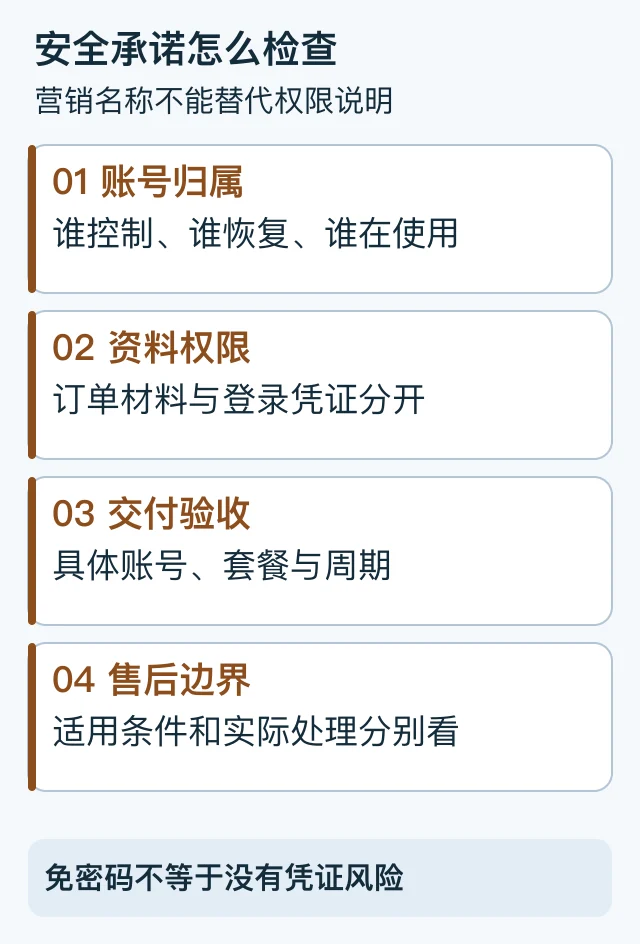

# ChatGPT代充安全不封号可信吗：先检查账号权限和承诺边界

首次发布与复核：2026-10-19。由 PayForGPT 与 Nano Banana 内容运营方整理。

## “不封号”不能替代哪几项检查？

购买前检查**账号归属、资料权限、实际交付和售后承诺**。本教程没有证据把任一商家、外卡、IP标签或实体SIM判定为零封号风险；不能把营销承诺当作平台账号政策。



等价步骤：账号归属 → 资料权限 → 交付验收 → 售后边界。[SVG源](../assets/keyword-tasks-20261019/account-risk-check.svg)

## 第一项：独享账号和共享账号怎么分？

问清楚谁创建、谁控制、谁能恢复账号，以及是否多人使用同一登录凭证。OpenAI账号面向创建者本人；同一人使用多台设备与多人共用账号不是一回事。[官方账号使用政策](https://help.openai.com/en/articles/10471989-openai-account-sharing-policy)

“独享”“原号”“专属车位”只是商品描述，不能单凭词语推导官方授权或零风险。购买后仍需核对真实交付对象。

## 第二项：免密代充安全吗？

不要求密码，仍可能要求其他有访问能力的资料。Cookie、Session JSON、访问令牌与API key不是普通订单材料；各自的权限、有效期和撤销方式也不能混为一谈。OWASP说明有效会话标识可能临时承载认证能力。[会话管理说明](https://cheatsheetseries.owasp.org/cheatsheets/Session_Management_Cheat_Sheet.html)

```text
付款或核单需要的材料：订单号、必要的脱敏交易信息
我被要求提交的额外资料：
接收方、用途、访问权限、保存及撤销说明：
哪些说明尚未确认：
```

不要在公开工单、聊天记录或源码中提交密码、验证码、完整Cookie/Session或API key。具体材料分级看[订单证据与账号钥匙](04-account-credentials-and-order-evidence.md)。

## 第三项：把保证写成可核对的条款

| 商家说法 | 应进一步确认 |
| --- | --- |
| 免密 | 实际还要什么资料，权限与处理方式是什么？ |
| 已到账 | 哪个账号、什么套餐、什么周期，怎样验收？ |
| 售后保障 | 适用问题、材料、期限与处理方分别是什么？ |
| 退款 | 是否有明确资格与流程，如何处理已有访问权限？ |
| 不封号 | 依据是什么，哪些结果不受商家控制？ |

退款、订单关闭和账号访问撤销分别确认。某项售后承诺即使存在，也不能替代平台规则或保证实际履行。

## 第四项：怀疑资料泄露怎么办？

先停止在原聊天或公开页面继续发送资料，按凭证所属平台的官方流程处理账号会话、密码或具体key，再记录事件与联系渠道。不同凭证采取不同措施；不要把删除消息、退出某一设备或收到退款当作所有访问已撤销。[OpenAI账号安全](https://help.openai.com/en/articles/8304786-keeping-your-openai-account-secure)、[API key安全](https://help.openai.com/en/articles/5112595-best-practices-for-api-key-safety)

## 常见问题

**ChatGPT代充一定会封号吗？** 本文没有对某商家或交易建立这样的概率结论，也没有零风险结论。按账号政策与具体证据判断。

**Session JSON一定能完全接管账号吗？** 不能把所有凭证的权限说成相同；但有效会话资料需要按敏感访问材料对待。

**有实体卡或住宅IP就安全了吗？** 这些不能单独证明平台资格、账号控制或付款结果，见[网络标签解释](01-ip-check-tutorial.md)。

选择商品时，可用[六项平台核对表](15-provider-selection.md)。本文未执行账号授权、泄露实验或封号率测试。
